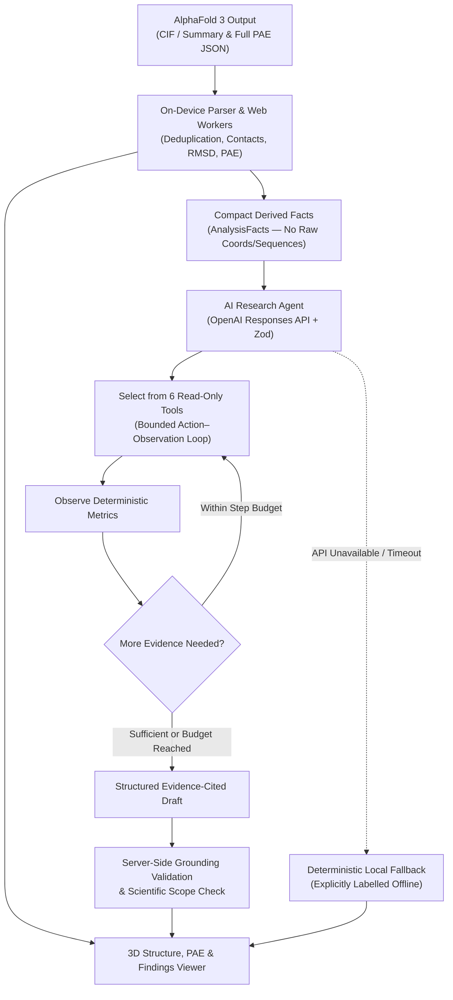

# FoldLens

[日本語](README.md) | English

**Turning AlphaFold 3 predictions into data-quality-checked, deterministically grounded scientific reviews.**

FoldLens is a **local-first AI research workspace** for interpreting, comparing, and auditing AlphaFold 3 predictions. It unifies 3D molecular visualization, confidence/PAE inspection, cross-model geometric and contact analysis, and a tool-using AI research agent that grounds every claim in deterministic measurements.

Originally built for the Work & Productivity track of OpenAI Build Week 2026 from the intersection of pharmacy, structural biology, and AI engineering, FoldLens has evolved to include automated data-quality checks (duplicate-coordinate detection), a versioned deterministic finding engine, a six-tool research agent, a macOS desktop application, and a metered web architecture.

[Original public repository](https://github.com/Shunsuke-max/foldlens) · [macOS releases](https://github.com/Shunsuke-max/foldlens-releases/releases)

> **Three Core Design Pillars for Drug Discovery & Structural R&D**
> 1. **Confidentiality by Design (Local-First)**: Source CIF/PAE JSON files, atomic coordinates, and sequences are parsed on-device (browser / Web Workers); only compact derived metrics (`AnalysisFacts`) reach the LLM.
> 2. **Data-Quality Gating & Deterministic Computation**: Detects duplicate coordinates before cross-model consensus analysis and computes heavy-atom Jaccard overlap, interface RMSD, and reciprocal PAE independently of the LLM.
> 3. **Auditable Tool-Using AI Agent**: Executes bounded read-only loops across six deterministic inspection tools, with server-side grounding and structured schema validation.

*Implemented interface captured on September 9, 2026. The teaching sample reuses experimental [RCSB PDB 4HLA](https://www.rcsb.org/structure/4HLA) coordinates with illustrative confidence values rather than independent AlphaFold 3 predictions. FoldLens automatically detects that all five loaded files share identical coordinates and flags cross-model reproducibility as unassessable.*

---

## 1. The Problem — Obtaining a Prediction Is Not the Same as Evaluating It

While models like AlphaFold 3 have transformed structural biology, practical post-prediction review still suffers from critical workflow gaps:

* **Fragmented evidence**: Moving between molecular viewers, confidence JSON files (pLDDT / pTM / ipTM), PAE heatmaps, and multiple predicted models makes it easy to lose track of which score supports which interface or residue range.
* **Hidden data-quality traps**: Duplicate or non-independent coordinate files can create a false impression of multi-model consensus unless explicitly checked before aggregation.
* **Ungrounded LLM summaries**: Asking a general-purpose chatbot to explain a prediction cannot guarantee numeric traceability, transparent thresholds, or falsification conditions.

FoldLens is not a structure predictor or docking tool; it is a **structured scientific review environment** designed to clarify what to inspect first, which measurements support each finding, and where prediction boundaries lie.

---

## 2. Deterministic Analysis & Data-Quality Controls

Before any AI reasoning runs, FoldLens executes a deterministic on-device pipeline to validate data integrity and compute geometric and confidence metrics.

### Data-Quality Gate (Duplicate-Coordinate Detection)
Before evaluating cross-model reproducibility, FoldLens compares **chain- and residue-labelled backbone coordinates at 0.001 Å precision** (without equating rigid-body transforms or homomer chain swaps) to verify the number of unique coordinate sets. When coordinates are duplicated, cross-model reproducibility is explicitly blocked and surfaced as a data-quality warning.

### Versioned Deterministic Metrics (Initial Heuristic Rules)
Every heuristic threshold used to generate findings is explicitly versioned and inspectable in the UI so researchers can audit assumptions rather than trusting opaque outputs:

| Rule ID | Metric | Initial Threshold | Role & Scope |
| :--- | :--- | :---: | :--- |
| `interface-consensus-fraction-v1` | Consensus model fraction | `0.8` | Initial rule for cross-model interface reproducibility |
| `contact-cutoff-5a` | Heavy-atom contact distance | `5 Å` | Polymer `ATOM` heavy-atom contacts (excludes ligands/`HETATM`) |
| `contact-jaccard-v1` | Contact overlap (Jaccard index) | `0.5` | Quantifies contact-map overlap against the consensus reference |
| `interface-rmsd-v1` | Superposed interface RMSD | `3 Å` | Measures local interface geometric spread across models |
| `global-rmsd-v1` | Complex backbone RMSD | `2.5 Å` | Measures global conformational agreement across models |
| `interface-pae-context-v1` | Reciprocal interface PAE | `10 Å` | Confidence context preserving PAE directionality (A→B / B→A) |

*These thresholds are initial review heuristics; expert calibration against real AlphaFold 3 prediction corpora remains an explicit next step.*

---

## 3. Product Walkthrough (Implemented Interface)

The screenshots below were captured during the September 9, 2026 implementation audit (illustrating the review workflow on synthetic teaching data; the Japanese UI is shown as captured and does not represent a live AI benchmark).

### Step 1 — Inspect Findings Linked Directly to 3D Structure & PAE

Each finding links directly to its molecular region, supporting measurements (contact overlap, reciprocal PAE), and interactive PAE matrix—allowing researchers to inspect primary evidence before asking the AI agent.

### Step 2 — Compare Models Beyond a Single Confidence Score

Exposes per-model global RMSD, interface RMSD, and heavy-atom contact overlap relative to the reference model, explicitly noting that an outlier indicates divergence from the loaded group rather than proof of error.

### Step 3 — Audit Methods and Threshold Assumptions

Surfaces exact distance cutoffs, Jaccard and RMSD rules, included atom types, and calibration status directly in the review interface.

[See the original July 2026 implementation screenshot](https://github.com/Shunsuke-max/foldlens/blob/main/docs/audit-2026-07-21/06-desktop-workspace-fresh.png)

---

## 4. AI Research Agent Architecture

### Separating Deterministic Calculation from LLM Reasoning

### Six Read-Only Deterministic Analysis Tools

The agent dynamically selects only the tools needed for the user's question, and the full **Research path** (tool calls and observations) remains visible to the researcher:

| Tool Name | Read-Only Deterministic Function |
| :--- | :--- |
| `inspect_overall_confidence` | Reads ranking score, pTM, overall ipTM, clash status, and confidence availability |
| `inspect_interface` | Reads deterministic ipTM, reciprocal PAE, low-PAE fraction, and coordinate-contact counts for a chain pair |
| `find_uncertain_regions` | Identifies weakest local pLDDT regions or highest-uncertainty PAE structural regions |
| `inspect_selected_region` | Computes reciprocal PAE statistics and residue ranges for the user-selected PAE matrix region |
| `compare_predictions` | Compares selected deterministic summary metrics across loaded prediction models |
| `compare_interface_consistency` | Evaluates cross-model interface reproducibility via confidence support and coordinate-contact overlap |

### Design Decisions for Scientific Trust & Data Security

| Design Decision | Rationale |
| :--- | :--- |
| **Local-first parsing in browser / Web Workers** | Prevents unnecessary transfer of confidential drug-discovery sequences and atomic coordinates |
| **Strict calculation vs. language separation** | Server materializes rounded metrics, evidence cards, and viewer actions from deterministic facts to eliminate numeric hallucination |
| **Bounded Action–Observation tool loop** | Balances transparent multi-step reasoning with predictable API cost and latency |
| **Schema-enforced caveats & scope boundaries** | Zod Structured Outputs enforce competing interpretations, falsification conditions, and strict rejection of clinical/in-vivo efficacy claims |
| **Deterministic offline fallback** | Gracefully falls back to a local analyzer with the same response contract and an explicit offline label if live AI is unavailable |

---

## 5. Evolution from Prototype to Product & Verification Architecture

| Area | Original Public Release (July 2026) | Current Development (Private Repository) |
| :--- | :--- | :--- |
| **AI Architecture** | Single-pass evidence-linked structured answer | Six-tool research agent with inspectable Research path |
| **Scientific Analysis** | Confidence metrics & PAE viewer | Duplicate-coordinate gate, heavy-atom contacts, Jaccard/interface RMSD, Web Worker execution |
| **Delivery** | Web workspace | Web service architecture + Electron macOS desktop application |
| **Service & Cost Design** | Basic IP rate limiting | Authentication (Supabase), mode-based credit reservation/settlement, Stripe billing |
| **Quality & Verification** | Parser & UI regression tests | Automated test suites across parsing, contacts, agent eval, and billing; corpus calibration (`calibrate_af3_corpus`) and analysis benchmarking (`benchmark_analysis`) scripts |

### Technology Stack

| Layer | Technologies |
| :--- | :--- |
| **Frontend & Visualization** | React 19, TypeScript, Vite, 3Dmol.js, Web Workers |
| **Backend & AI** | Express 5, OpenAI Responses API, Zod 4 |
| **Auth, Billing & Security** | Supabase, Stripe, Turnstile, rate limiting & crypto utilities |
| **Desktop & Delivery** | Electron, Electron Forge, Vercel, Render |
| **Testing & Validation** | Vitest, Testing Library, TypeScript (`tsc --noEmit`) |

---

## 6. My Role & AI-Assisted Engineering

I approached FoldLens not as an LLM wrapper exercise, but as a scientific software and product-design challenge: **what evidence do life scientists actually need to trust an AI-assisted structural review, and where must deterministic computation end and human/experimental judgment begin?**

While using Codex as an iterative engineering and design partner, I owned the core architectural and scientific decisions: enforcing the local-first privacy boundary, introducing duplicate-coordinate checks and versioned deterministic rules, requiring server-side evidence grounding with explicit falsification conditions, and structuring metered service economics for sustainable operation.

---

## 7. Scientific Scope, Current Status & Attribution

* **Scientific boundaries**: Heavy-atom contact overlap and RMSD are geometric heuristics, not binding-energy calculations or proof of biological interaction. Distinct coordinates do not prove independent prediction seeds, and heuristic thresholds require expert calibration on real AlphaFold 3 outputs. FoldLens does not perform structure prediction, docking, clinical decision-making, or experimental validation.
* **Current status**: The macOS app supports local analysis and session storage; live AI, authentication, and billing are web capabilities pending configured-environment end-to-end validation. While automated test, benchmark, and billing workflows are implemented, this portfolio does not claim independently verified pass rates, performance gains, user adoption, or commercial revenue.
* **Next steps**: Calibrate heuristic findings with structural biologists on real AlphaFold 3 prediction corpora, evaluate workflow usability and evidence quality with researchers, and measure per-mode token costs and billing lifecycles in live environments.
* **Scope & attribution**: This repository is a product and engineering portfolio (original source: [Shunsuke-max/foldlens](https://github.com/Shunsuke-max/foldlens); current development source is private). FoldLens is an independent project, not an official AlphaFold product. AlphaFold Server outputs are subject to their [applicable terms](https://alphafoldserver.com/output-terms). Teaching coordinates use [RCSB PDB 4HLA](https://www.rcsb.org/structure/4HLA) and visualization uses [3Dmol.js](https://3dmol.org/).
