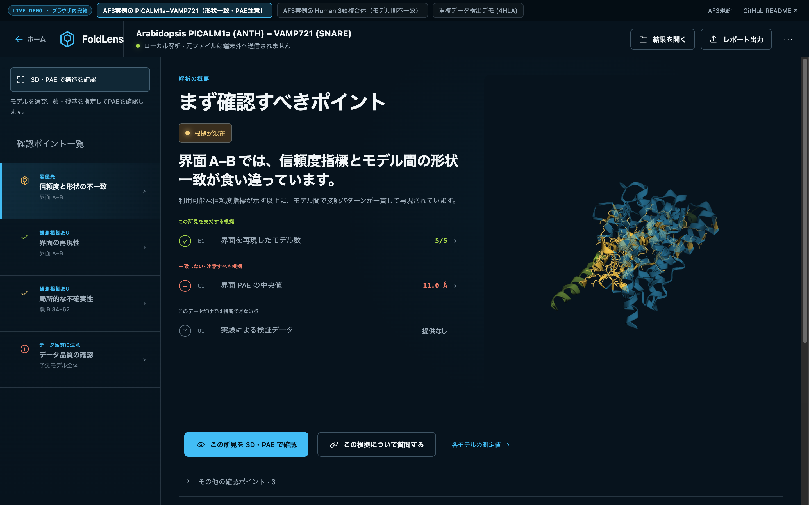
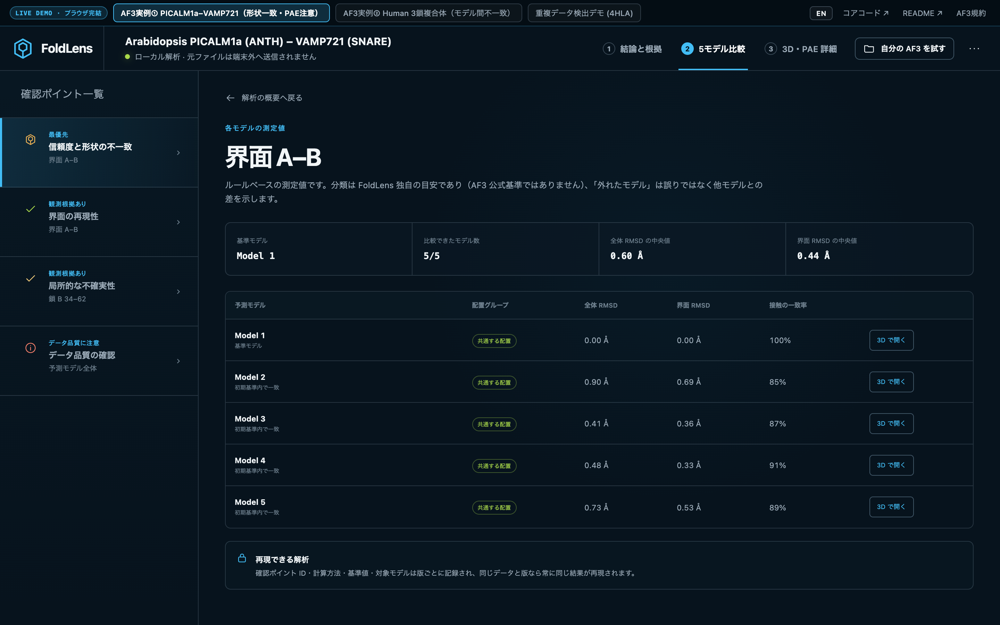
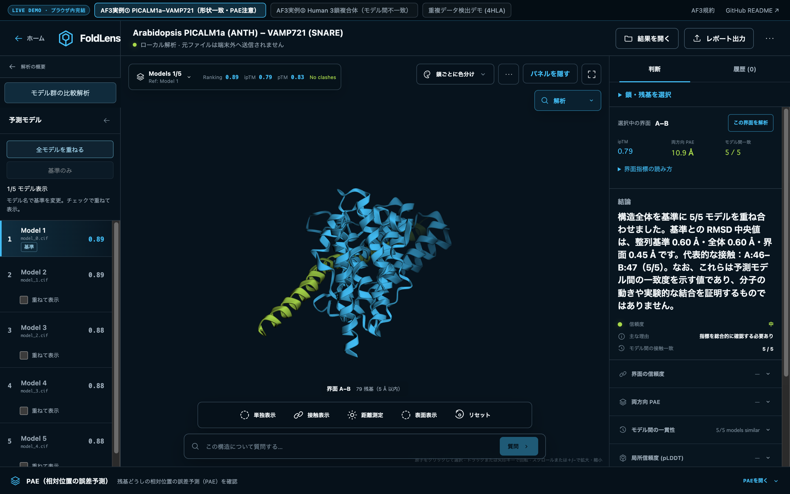
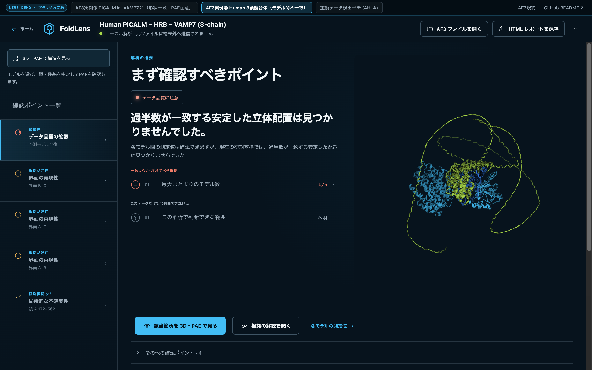
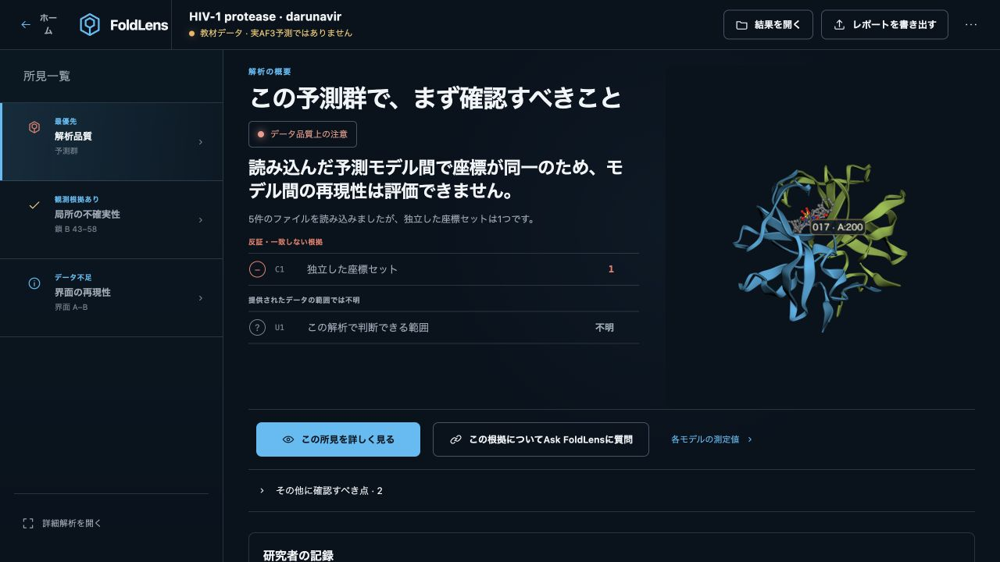
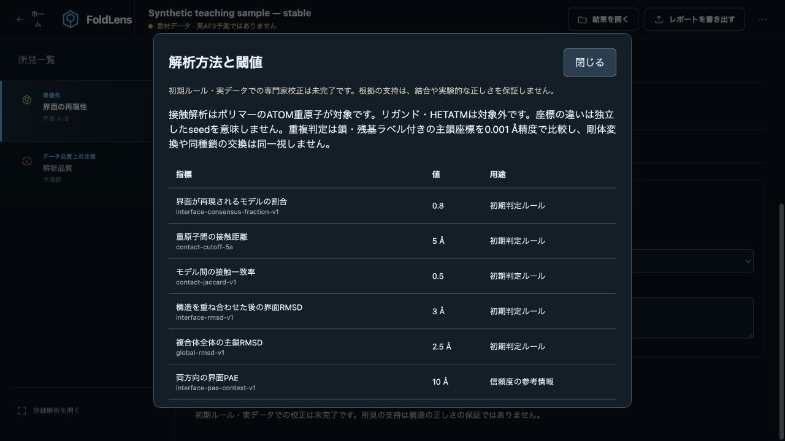
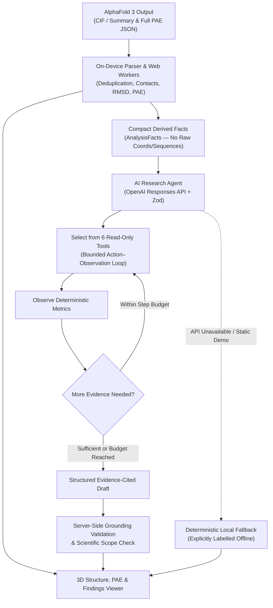

# FoldLens

[日本語](README.md) | English

**Turning AlphaFold 3 predictions into data-quality-checked, deterministically grounded scientific reviews.**

[-0ea5e9?style=for-the-badge)](https://shunsuke-max.github.io/foldlens-portfolio/)
[-22c55e?style=flat-square)](https://github.com/Shunsuke-max/foldlens-core/blob/main/README.en.md)

[-6366f1?style=flat-square)](https://shunsuke-max.github.io/foldlens-portfolio/?case=4hla)

> **▶ [Launch Interactive Browser Demo (Zero Install · No API Key · 100% Client-Side)](https://shunsuke-max.github.io/foldlens-portfolio/)**  
> Preloaded with two real AlphaFold 3 Server prediction ensembles (5 models each). All CIF/PAE parsing, heavy-atom contact comparison, 3Dmol.js rendering, and deterministic offline analysis execute locally inside browser Web Workers—you can also drag and drop your own AF3 ZIP without uploading raw coordinates.

FoldLens is a **local-first AI research workspace** for interpreting, comparing, and auditing AlphaFold 3 predictions. It unifies 3D molecular visualization, confidence/PAE inspection, cross-model geometric and contact analysis, and a tool-using AI research agent that grounds every claim in deterministic measurements.

Originally built for the Work & Productivity track of OpenAI Build Week 2026 from the intersection of pharmacy, structural biology, and AI engineering, FoldLens has evolved to include automated data-quality checks (duplicate-coordinate detection), a versioned deterministic finding engine, a six-tool research agent, a macOS desktop application, and a metered web architecture.

[▶ Live Demo (GitHub Pages)](https://shunsuke-max.github.io/foldlens-portfolio/) · [**Core Engine & Tests (`foldlens-core`)**](https://github.com/Shunsuke-max/foldlens-core/blob/main/README.en.md) · [macOS releases](https://github.com/Shunsuke-max/foldlens-releases/releases) · [Archived v1 prototype](https://github.com/Shunsuke-max/foldlens)

> **Three Core Design Pillars for Drug Discovery & Structural R&D**
> 1. **Confidentiality by Design (Local-First)**: Source CIF/PAE JSON files, atomic coordinates, and sequences are parsed on-device (browser / Web Workers); only compact derived metrics (`AnalysisFacts`) reach the LLM.
> 2. **Data-Quality Gating & Deterministic Computation**: Detects duplicate coordinates before cross-model consensus analysis and computes heavy-atom Jaccard overlap, interface RMSD, and reciprocal PAE independently of the LLM.
> 3. **Auditable Tool-Using AI Agent**: Executes bounded read-only loops across six deterministic inspection tools, with server-side grounding and structured schema validation.

*Deterministic browser-side review of a real 5-model AlphaFold 3 Server output (`Arabidopsis PICALM1a ANTH – VAMP721 SNARE`). Although 5/5 models reproduce the A–B contact interface, FoldLens automatically flags the 11.0 Å median interface PAE (exceeding its 10 Å heuristic threshold) as a `confidence_geometry_conflict` finding (Japanese UI shown; full EN/JA toggle available in the live demo).*

---

## 1. Real AlphaFold 3 Case Studies — High Geometric Consensus vs. Ensemble Divergence

To evaluate how FoldLens surfaces issues hidden behind a single summary score (`ranking_score` or `ipTM`), we analyzed two contrasting real AlphaFold 3 Server outputs (public wild-type sequences, 5 independent coordinate models each). Both cases are preloaded in the [live demo](https://shunsuke-max.github.io/foldlens-portfolio/) for instant 1-click switching.

### Quantitative Comparison (Deterministic FoldLens Engine Output)

| Metric / Finding | Case 1: Arabidopsis PICALM1a (ANTH) – VAMP721 (SNARE) ([Open in Live Demo](https://shunsuke-max.github.io/foldlens-portfolio/?case=vamp721)) | Case 2: Human PICALM – HRB – VAMP7 ([Open in Live Demo](https://shunsuke-max.github.io/foldlens-portfolio/?case=human)) |
| :--- | :--- | :--- |
| **System & Models** | 2 chains (310 aa + 62 aa) · 5 models (5/5 unique coords) | 3 chains (562 aa + 652 aa + 220 aa) · 5 models (5/5 unique coords) |
| **AF3 Summary Scores** | `ranking_score`: `0.88–0.89` · `pTM`: `0.83` · `ipTM`: `0.79` | `ranking_score`: `0.40–0.54` · `pTM`: `0.31–0.34` · `ipTM`: `0.20–0.24` |
| **Median Global RMSD** | **`0.60 Å`** (range `0.41–0.90 Å`) | **`60.33 Å`** (range `58.84–62.47 Å`) |
| **Median Interface RMSD** | **`0.44 Å`** (range `0.33–0.69 Å`) | **`25.36 Å`** (range `23.50–26.85 Å`) |
| **Heavy-Atom Contact Jaccard** | Median **`88–89%`** (range `85%–91%`) | Median **`40%`** (drops to **`13%`** in Model 3) |
| **Primary Automated Finding** | **`confidence_geometry_conflict` (`mixed`)** 5/5 models reproduce contacts, yet median interface PAE is `11.0 Å` (> `10 Å` rule) | **`analysis_quality` (`quality_warning`)** No dominant structural group (`1/5` in largest cluster); warns against single-model interpretation |
| **Local Uncertainty Pinpointed** | **Chain B 34–62** (mean pLDDT `49` · very low, overlapping A–B interface) | **Chain A 172–562** (mean pLDDT `29` · very low, PICALM's long IDR tail) |
| **Scientific / DS Takeaway** | Prevents over-interpreting `ipTM 0.79` by isolating flexible C-terminal SNARE residues and moderate PAE uncertainty | Decomposes 3-chain interfaces: A–C splits into `3/5` (`ipTM 0.47–0.49`) vs. `2/5` (`0.12–0.13`), while isolating the IDR driving 60 Å global RMSD |

---

### Case 1 — Catching Confidence–Geometry Tension Inside a High-Scoring Complex

Using the same plant endocytosis molecular system studied in [vamp721-structural-ensemble](https://github.com/Shunsuke-max/vamp721-structural-ensemble/blob/main/README.en.md) (`PICALM1a ANTH` + `VAMP721 SNARE`):

#### Per-Model Geometric Agreement (`5/5` Consistent Models)

All 5 models converge tightly around the reference (`0.60 Å` median global RMSD, `0.44 Å` median interface RMSD, `85%–91%` heavy-atom contact overlap).

#### Linked 3D Structure, PAE Domain Map & Deterministic Summary

Rather than stopping at `ipTM = 0.79`, FoldLens separates tightly anchored contacts from the **11.0 Å median interface PAE** and flags **Chain B 34–62 (mean pLDDT 49)** overlapping the interface—giving researchers a concrete boundary for follow-up experiments.

---

### Case 2 — Flagging Structural Divergence & IDR Instability in a 3-Chain Human Complex

For `Human PICALM – HRB (AGFG1) – VAMP7` (`fraction_disordered 0.55–0.56`):

* **Ensemble quality warning**: No structural cluster exceeds 50% of loaded models (`1/5` in largest group; `60.33 Å` median global RMSD), blocking naive consensus claims.
* **Pairwise interface decomposition**: Separates partial A–C reproducibility (`3/5` models at `chain_pair_iptm 0.47–0.49` vs. `2/5` dropping to `0.12–0.13`, `52%` median Jaccard) and B–C (`3/5`, `62%` Jaccard) from non-reproducible A–B contacts (`1/5`, `0%` median Jaccard).
* **Automated IDR isolation**: Flags **Chain A 172–562** (`mean pLDDT 29`) as a high-uncertainty region overlapping observed contacts.

---

## 2. Deterministic Analysis & Data-Quality Controls

Before any AI reasoning runs, FoldLens executes a deterministic on-device pipeline to validate data integrity and compute geometric and confidence metrics.

### Data-Quality Gate (Duplicate-Coordinate Detection)
Before evaluating cross-model reproducibility, FoldLens compares **chain- and residue-labelled backbone coordinates at 0.001 Å precision** (without equating rigid-body transforms or homomer chain swaps). You can test this directly in the live demo via [`Duplicate Gate (4HLA)`](https://shunsuke-max.github.io/foldlens-portfolio/?case=4hla), where five files sharing identical coordinates trigger an explicit unassessable-reproducibility block.

View duplicate-coordinate warning & transparent threshold audit screenshots

### Versioned Deterministic Metrics (Initial Heuristic Rules)

| Rule ID | Metric | Initial Threshold | Role & Scope |
| :--- | :--- | :---: | :--- |
| `interface-consensus-fraction-v1` | Consensus model fraction | `0.8` | Initial rule for cross-model interface reproducibility |
| `contact-cutoff-5a` | Heavy-atom contact distance | `5 Å` | Polymer `ATOM` heavy-atom contacts (excludes ligands/`HETATM`) |
| `contact-jaccard-v1` | Contact overlap (Jaccard index) | `0.5` | Quantifies contact-map overlap against the consensus reference |
| `interface-rmsd-v1` | Superposed interface RMSD | `3 Å` | Measures local interface geometric spread across models |
| `global-rmsd-v1` | Complex backbone RMSD | `2.5 Å` | Measures global conformational agreement across models |
| `interface-pae-context-v1` | Reciprocal interface PAE | `10 Å` | Confidence context preserving PAE directionality (A→B / B→A) |

*These thresholds are initial review heuristics; expert calibration against larger AlphaFold 3 prediction corpora (`calibrate_af3_corpus`) remains an explicit next step.*

---

## 3. AI Research Agent Architecture

### Separating Deterministic Calculation from LLM Reasoning

### Six Read-Only Deterministic Analysis Tools

| Tool Name | Read-Only Deterministic Function |
| :--- | :--- |
| `inspect_overall_confidence` | Reads ranking score, pTM, overall ipTM, clash status, and confidence availability |
| `inspect_interface` | Reads deterministic ipTM, reciprocal PAE, low-PAE fraction, and coordinate-contact counts for a chain pair |
| `find_uncertain_regions` | Identifies weakest local pLDDT regions or highest-uncertainty PAE structural regions |
| `inspect_selected_region` | Computes reciprocal PAE statistics and residue ranges for the user-selected PAE matrix region |
| `compare_predictions` | Compares selected deterministic summary metrics across loaded prediction models |
| `compare_interface_consistency` | Evaluates cross-model interface reproducibility via confidence support and coordinate-contact overlap |

### Design Decisions for Scientific Trust & Data Security

| Design Decision | Rationale |
| :--- | :--- |
| **Local-first parsing in browser / Web Workers** | Prevents unnecessary transfer of confidential drug-discovery sequences and atomic coordinates |
| **Strict calculation vs. language separation** | Server materializes rounded metrics, evidence cards, and viewer actions from deterministic facts to eliminate numeric hallucination |
| **Bounded Action–Observation tool loop** | Balances transparent multi-step reasoning with predictable API cost and latency |
| **Schema-enforced caveats & scope boundaries** | Zod Structured Outputs enforce competing interpretations, falsification conditions, and strict rejection of clinical/in-vivo efficacy claims |
| **Deterministic offline fallback** | Gracefully falls back to a local analyzer with the same response contract (powering the GitHub Pages static demo with zero backend calls) |

---

## 4. Evolution from Prototype to Product & Stack

| Area | Original Prototype (July 2026 · Archived) | Current Architecture (Public `foldlens-core` + Static Demo + Private App) |
| :--- | :--- | :--- |
| **AI Architecture** | Single-pass evidence-linked structured answer | Six-tool research agent with inspectable Research path + offline fallback |
| **Scientific Analysis** | Confidence metrics & PAE viewer | Duplicate-coordinate gate, heavy-atom contacts, Jaccard/interface RMSD, Web Worker execution |
| **Delivery** | Web workspace | [GitHub Pages interactive demo](https://shunsuke-max.github.io/foldlens-portfolio/) + Web service + Electron macOS app |
| **Service & Cost Design** | Basic IP rate limiting | Authentication (Supabase), mode-based credit reservation/settlement, Stripe billing |
| **Quality & Verification** | Parser & UI regression tests | Automated test suites across parsing, contacts, agent eval, and billing; corpus calibration (`calibrate_af3_corpus`) and benchmarking scripts |

**Stack**: React 19 · TypeScript · Vite · 3Dmol.js · Web Workers · Express 5 · OpenAI Responses API · Zod 4 · Supabase · Stripe · Electron · Vitest

---

## 5. My Role & AI-Assisted Engineering

I approached FoldLens not as an LLM wrapper exercise, but as a scientific software and data-engineering challenge: **what quantitative evidence do life scientists actually need to trust an AI-assisted structural review, and where must deterministic computation end and experimental validation begin?**

While using AI coding agents as iterative engineering partners, I owned the core architectural and scientific decisions: enforcing the local-first privacy boundary, introducing duplicate-coordinate checks and versioned deterministic rules, requiring evidence grounding with explicit falsification conditions, structuring metered service economics, and auditing UI copy with an explicit UX-writing standard ([Design Note (JP)](docs/ux-writing-in-scientific-ai.md) · [8-Point Checklist (JP)](docs/ux-writing-checklist.md)).

---

Scientific Scope, Terms of Use & Attribution (click to expand)

* **Scientific boundaries**: Heavy-atom contact overlap and RMSD are geometric heuristics, not binding-energy calculations or proof of biological interaction. Distinct coordinates do not prove independent prediction seeds, and heuristic thresholds require expert calibration on real AlphaFold 3 outputs. FoldLens does not perform structure prediction, docking, clinical decision-making, or experimental validation.
* **Static demo boundary**: The [GitHub Pages live demo](https://shunsuke-max.github.io/foldlens-portfolio/) is a client-only static build with no server, authentication, billing, external LLM calls, or source maps. All structure parsing and deterministic analysis execute locally in the browser.
* **AlphaFold Server Output Terms of Use**: The two real AlphaFold 3 Server prediction ensembles bundled in this non-commercial portfolio demo (model CIF and confidence JSON files unmodified; MSAs and template hits omitted for web delivery) are provided under and subject to the [AlphaFold Server Output Terms of Use](https://alphafoldserver.com/output-terms) (non-commercial use only; full copy bundled at [`ALPHAFOLD_SERVER_TERMS_OF_USE.md`](https://shunsuke-max.github.io/foldlens-portfolio/samples/ALPHAFOLD_SERVER_TERMS_OF_USE.md)).
* **Attribution**: FoldLens is an independent project and not an official AlphaFold product. The v0.2.8 deterministic engine, 6-tool grounded agent, calibration scripts, and tests are open-sourced at [Shunsuke-max/foldlens-core](https://github.com/Shunsuke-max/foldlens-core) (commercial auth/billing app kept private; live walkthrough available in interviews; original v1 prototype archived at [Shunsuke-max/foldlens](https://github.com/Shunsuke-max/foldlens)). Duplicate-gate teaching coordinates use [RCSB PDB 4HLA](https://www.rcsb.org/structure/4HLA); molecular rendering uses [3Dmol.js](https://3dmol.org/).

