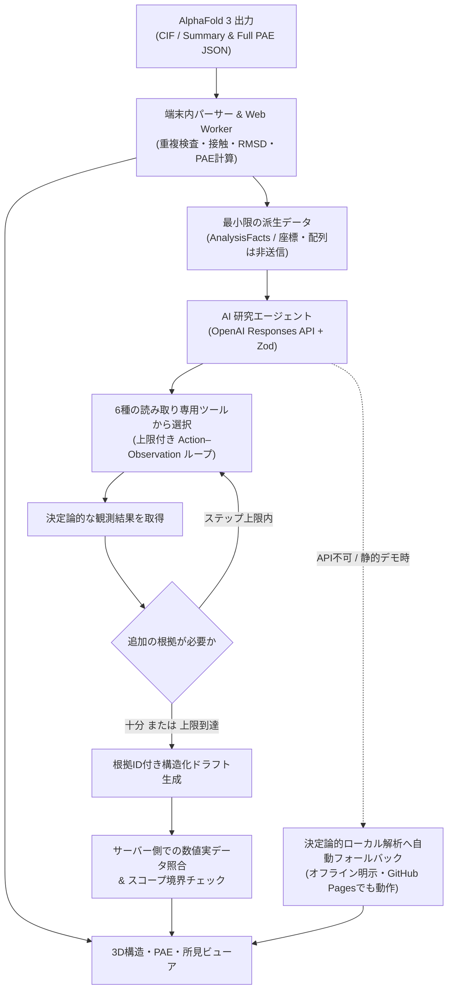

# FoldLens

日本語 | [English](README.en.md)

**AlphaFold 3 の構造予測結果を、データ品質チェックと決定論的な数値根拠に基づく科学的なレビューへ。**

[-0ea5e9?style=for-the-badge)](https://shunsuke-max.github.io/foldlens-portfolio/)

[-6366f1?style=flat-square)](https://shunsuke-max.github.io/foldlens-portfolio/?case=4hla)

> **▶ [ライブデモをブラウザで開く（インストール・APIキー不要／端末内完結）](https://shunsuke-max.github.io/foldlens-portfolio/)**  
> 実 AlphaFold 3 Server 出力 2 ケース（各 5 モデル）をプリロード済みです。ブラウザ上の Web Worker で CIF / PAE JSON を直接解析し、3D 分子表示・モデル間 RMSD／Jaccard 比較・PAE 連動・決定論的ローカル解析をそのまま体験できます（ご自身の AF3 ZIP をドラッグ＆ドロップしても外部送信されません）。

FoldLens は、AlphaFold 3 の予測結果を研究者が解釈・比較・検証するための**ローカルファーストな AI 研究支援ワークスペース**です。3D 分子可視化、信頼度・PAE 解析、複数予測モデル間の幾何・接触比較、そして決定論的な解析ツールを呼び出して根拠付きで回答する AI 研究エージェントを単一の環境へ統合しています。

薬学・生命科学とデータサイエンス／AI の接点から着想し、OpenAI Build Week 2026（Work & Productivity 部門）向けに初期版を開発しました。その後、重複座標などのデータ品質チェック、バージョン管理された決定論的所見エンジン、ツール選択型 AI エージェント、macOS デスクトップアプリ、および従量課金・認証を備えた Web アーキテクチャへと拡張しています。

[▶ Live Demo（GitHub Pages）](https://shunsuke-max.github.io/foldlens-portfolio/) · [初期版の公開ソースコード](https://github.com/Shunsuke-max/foldlens) · [macOS アプリ配布ページ](https://github.com/Shunsuke-max/foldlens-releases/releases)

> **創薬・構造研究における設計上の3つの要点**
> 1. **未公開構造の秘匿（ローカルファースト）**：元の CIF / PAE JSON・原子座標・配列は端末内（ブラウザ／Web Worker）で解析し、LLM には必要最小限の派生メトリクスのみを送信。
> 2. **データ品質ゲートと決定論的計算の分離**：複数モデルの比較前に重複座標を自動検出し、Jaccard 接触一致率・界面 RMSD・両方向 PAE などの定量指標を LLM から切り離して算出。
> 3. **監査可能な AI 研究エージェント**：6 種類の読み取り専用解析ツールを上限付きループで呼び出し、すべての数値・根拠参照をサーバー側で実データと照合・構造化検証。

*実 AlphaFold 3 Server 出力（`Arabidopsis PICALM1a ANTH – VAMP721 SNARE`・5モデル）をブラウザ内決定論エンジンで解析した画面。5/5 モデルで界面接触が一致する一方、界面 PAE 中央値が 11.0 Å であることを自動検知し、「信頼度指標と形状比較の不一致」を最優先所見として提示しています。*

---

## 1. 実 AlphaFold 3 データによるケーススタディ（高一貫性 vs 構造不一致の対比）

単一のスコア（`ranking_score` や `ipTM`）だけでは見落としやすい構造予測の落とし穴を、公開野生型配列に対する**実 AlphaFold 3 Server 出力 2 ケース（各 5 モデル・独立座標 5/5）**で検証しました。いずれも [ライブデモ](https://shunsuke-max.github.io/foldlens-portfolio/) 上部バーから 1 クリックで切り替えて再現できます。

### 2ケースの決定論的定量比較（FoldLens 自動解析エンジン出力）

| 評価項目 | Case 1：Arabidopsis PICALM1a (ANTH) – VAMP721 (SNARE) （[ライブデモで開く](https://shunsuke-max.github.io/foldlens-portfolio/?case=vamp721)） | Case 2：Human PICALM – HRB – VAMP7 （[ライブデモで開く](https://shunsuke-max.github.io/foldlens-portfolio/?case=human)） |
| :--- | :--- | :--- |
| **構成・予測数** | 2 鎖（310 aa + 62 aa）・5 モデル（独立座標 5/5） | 3 鎖（562 aa + 652 aa + 220 aa）・5 モデル（独立座標 5/5） |
| **AF3 総合スコア範囲** | `ranking_score`: `0.88–0.89` / `pTM`: `0.83` / `ipTM`: `0.79` | `ranking_score`: `0.40–0.54` / `pTM`: `0.31–0.34` / `ipTM`: `0.20–0.24` |
| **全体 RMSD 中央値** | **`0.60 Å`**（範囲 `0.41–0.90 Å`） | **`60.33 Å`**（範囲 `58.84–62.47 Å`） |
| **界面 RMSD 中央値** | **`0.44 Å`**（範囲 `0.33–0.69 Å`） | **`25.36 Å`**（範囲 `23.50–26.85 Å`） |
| **重原子接触 Jaccard 一致率** | 中央値 **`88–89%`**（範囲 `85%–91%`） | 中央値 **`40%`**（Model 3 は **`13%`** まで低下） |
| **最優先所見（自動判定）** | **`confidence_geometry_conflict`（根拠が混在）** 界面再現 `5/5` に対し、界面 PAE 中央値 `11.0 Å`（閾値 `10 Å` 超） | **`analysis_quality`（データ品質上の注意）** 支配的構造群なし（最大群 `1/5`）。単一代表モデルの採用を警告 |
| **局所不確実性の自動特定** | **Chain B 34–62**（平均 pLDDT `49`・very low、界面と重複） | **Chain A 172–562**（平均 pLDDT `29`・very low、PICALM の長い IDR） |
| **研究・DS 上の示唆** | `ipTM 0.79` だけを見て鵜呑みにせず、SNARE 後半部の柔軟性と PAE 境界を優先検証すべきことが明確化 | 鎖ペア分解により、A–C が `3/5`（`ipTM 0.47–0.49`）と `2/5`（`0.12–0.13`）に分岐する構造乖離と IDR 影響を定量分離 |

---

### Case 1：高スコア複合体でも「形状再現性 vs PAE・局所不確実性」を自動分離する

植物エンドサイトーシスにおける PICALM1a（ANTH ドメイン）– VAMP721（SNARE モチーフ）複合体（[VAMP721–PICALM1a 配座アンサンブル解析リポジトリ](https://github.com/Shunsuke-max/vamp721-structural-ensemble) と同一分子系）の実 AF3 出力です。

#### ① モデル間の幾何・接触一致率（5モデルすべてで界面が安定再現）

全 5 モデルで `ranking_score 0.88–0.89`・`ipTM 0.79`、全体 RMSD 中央値 `0.60 Å`、界面 RMSD 中央値 `0.44 Å`、重原子接触一致率 `85%–91%` と極めて高い幾何学的収束を示します。

#### ② 3D 構造・ドメインマップ・決定論的結論の連動ワークスペース

一方で FoldLens は、**界面 PAE 中央値が `11.0 Å`（初期閾値 `10 Å` を超過）**であることと、**VAMP721 側 34–62 残基の平均 pLDDT が `49`** で界面領域と重なることを自動検出し、「どの界面領域は堅牢で、どこに不確実性が残るか」を単一スコアの裏側から引き出します。

---

### Case 2：天然変性領域（IDR）を含む 3 鎖複合体の構造分岐を自動警告する

ヒト PICALM–HRB（AGFG1）–VAMP7 の 3 鎖複合体（各鎖に長い変性領域を含み `fraction_disordered 0.55–0.56`）の実 AF3 出力です。

* **支配的構造群の欠如を自動検知**：最大構造群が `1/5` にとどまるため、FoldLens は「過半数を占める安定配置は見つからなかった」と品質警告を最優先表示します。
* **鎖ペアごとの乖離を分解**：A–C（PICALM–VAMP7）界面は Model 1/2/5 で `chain_pair_iptm 0.47–0.49` を示す一方、Model 3/4 では `0.12–0.13` へ急落（再現 `3/5`・接触一致率中央値 `52%`）。A–B 界面は `1/5`（一致率 `0%`）と不安定であることを定量的に切り分けます。
* **IDR 領域の自動同定**：Chain A 172–562（平均 pLDDT `29`）を局所不確実領域として自動抽出し、全体 RMSD が `60.33 Å` に膨らむ構造要因を可視化します。

---

## 2. 課題背景とデータ品質ゲート（決定論的メトリクス設計）

AlphaFold 3 などの構造予測モデルは生命科学・創薬研究を大きく前進させましたが、実務レビューには次の課題が残ります。

* **判断材料の分断**：分子ビューア、信頼度 JSON（pLDDT / pTM / ipTM）、PAE ヒートマップ、複数予測モデルを行き来するうちに、どのスコアがどの鎖ペア・残基領域に対応するのか追跡しにくくなる。
* **データ品質の見落とし**：同一座標ファイルが重複していても、見かけ上「複数モデルで一致」と誤認してしまうリスクがある。
* **汎用 LLM の信頼性不足**：汎用チャットボットに要約させるだけでは、数値の算出根拠・閾値の前提・科学的な反証条件を検証できない。

### データ品質ゲート（重複座標の自動検出）
複数モデルの再現性を評価する前に、**鎖・残基ラベル付きの主鎖座標を `0.001 Å` 精度で比較**し、独立した座標セット数を検査します（剛体変換や同種鎖の交換は同一視しません）。ライブデモの [`重複座標ゲート (4HLA)`](https://shunsuke-max.github.io/foldlens-portfolio/?case=4hla) では、同一座標の 5 ファイルに対して「モデル間再現性は評価不可」と自動ブロックする挙動を確認できます。

重複座標ゲート・解析方法パネルの実装画面を見る（クリックで展開）

*同一座標 5 ファイル（教材データ PDB 4HLA）を読み込んだ際、重複座標を自動検出してモデル間再現性評価をブロックする様子。*

*所見の根拠となった距離カットオフ・Jaccard 係数・RMSD 閾値・未校正である旨を UI 上で透過的に監査可能。*

### バージョン管理された決定論的メトリクス（初期レビュー規則）

| ルール識別子 | 指標 | 初期閾値 | 設計上の役割・前提 |
| :--- | :--- | :---: | :--- |
| `interface-consensus-fraction-v1` | 界面が再現されるモデルの割合 | `0.8` | 複数モデル間で共通界面とみなす一致割合の初期規則 |
| `contact-cutoff-5a` | 重原子間の接触距離 | `5 Å` | ポリマー `ATOM` 重原子間の界面接触判定（リガンド・`HETATM` 除外） |
| `contact-jaccard-v1` | モデル間の接触一致率（Jaccard 係数） | `0.5` | 基準モデルとの重原子接触マップ重複度の定量評価 |
| `interface-rmsd-v1` | 構造重ね合わせ後の界面 RMSD | `3 Å` | 局所的な界面配置のモデル間ばらつき評価 |
| `global-rmsd-v1` | 複合体全体の主鎖 RMSD | `2.5 Å` | 複合体全体のコンフォメーション一致度の評価 |
| `interface-pae-context-v1` | 両方向の界面 PAE | `10 Å` | PAE の方向性（A→B / B→A）を考慮した信頼度コンテキスト |

※上記は初期の経験的ルールであり、実 AlphaFold 3 予測コーパスと専門家評価による校正（`calibrate_af3_corpus`）を継続課題として位置づけています。

---

## 3. AI 研究エージェントのアーキテクチャ

### 「LLM に計算させず、決定論的ツールの観測結果に基づいて推論させる」

### エージェントが利用する 6 種類の読み取り専用解析ツール

| ツール名 | 役割（すべて読み取り専用・決定論的） |
| :--- | :--- |
| `inspect_overall_confidence` | ランキングスコア、pTM、全体 ipTM、クラッシュ有無、信頼度データの利用可否を取得 |
| `inspect_interface` | 指定鎖ペアの ipTM、両方向 PAE、低 PAE 割合、座標ベースの接触数を取得 |
| `find_uncertain_regions` | 局所 pLDDT が低い領域や PAE 上で不確実性の高い領域を抽出 |
| `inspect_selected_region` | ユーザーが PAE 行列上で選択した残基範囲の両方向 PAE 統計を取得 |
| `compare_predictions` | 読み込んだ複数予測モデル間で選択メトリクスを横断比較 |
| `compare_interface_consistency` | 信頼度支持と重原子接触重複率から、複数モデル間の界面一貫性を比較 |

### 科学的信頼性とセキュリティのための設計判断

| 設計判断 | 理由・狙い |
| :--- | :--- |
| **原データを端末内（Web Worker）で処理** | 未公開の創薬ターゲット配列・立体座標を外部 API へ送信しないローカルファースト境界の徹底 |
| **数値計算と自然言語生成の厳密な分離** | 回答に含まれる測定値・根拠カード・ビューア操作をサーバー側で実データから生成し、数値捏造を防止 |
| **ステップ上限付きツールループ** | 解析プロセスの透明性（Research path）と API 計算コスト・レイテンシの上限管理を両立 |
| **反証条件・代替解釈・スコープ境界の強制** | Zod 構造化出力により、臨床有効性・投薬・in vivo 結合などの過剰主張を禁止し、不確実性を明示 |
| **決定論的ローカルフォールバック** | API 未接続環境（GitHub Pages 静的デモを含む）でも同一レスポンス構造でオフライン解析へ切替・明示 |

---

## 4. プロトタイプからプロダクトへの発展と技術スタック

| 領域 | 初期版（2026年7月・公開） | 現在の開発（非公開本体 ＋ クライアント静的デモ公開） |
| :--- | :--- | :--- |
| **AI アーキテクチャ** | 根拠付き構造化回答（単発） | 6ツール選択型研究エージェント＋観測過程（Research path）表示＋オフラインフォールバック |
| **科学的解析** | 信頼度・PAE ビューア | 重複座標検出、重原子接触・Jaccard・界面 RMSD、Web Worker 非同期解析 |
| **提供形態** | Web ワークスペース | [GitHub Pages 静的ライブデモ](https://shunsuke-max.github.io/foldlens-portfolio/) ＋ Web サービス構成 ＋ Electron macOS アプリ |
| **サービス・原価設計** | IP ベースの簡易レート制限 | 認証（Supabase）、解析モード別クレジット予約・確定、課金基盤（Stripe） |
| **品質管理・検証設計** | パーサー・UI の回帰テスト | パーサー・接触解析・エージェント評価・課金整合性の自動テスト群、実データ校正（`calibrate_af3_corpus`）・ベンチマーク基盤 |

**技術スタック**：React 19 / TypeScript / Vite / 3Dmol.js / Web Workers / Express 5 / OpenAI Responses API / Zod 4 / Supabase / Stripe / Electron / Vitest

---

## 5. 自身の役割と AI 協調開発

FoldLens は「LLM をアプリに組み込むこと」自体が目的ではなく、**「生命科学の研究者が実際に意思決定に使える情報設計とは何か」「AI に任せてよい推論と、決定論的計算に固定すべき事実の境界はどこか」**をプロダクトとして検証した取り組みです。

開発では AI コーディングエージェント（Codex / Antigravity 等）を実装・テスト・リファクタリングのパートナーとして活用しつつ、以下のコア意思決定を一貫して主導しました。
* 未公開の分子構造・配列を外部送信しないローカルファースト境界の設計
* 重複座標検出やバージョン管理された決定論的ルールによるデータ品質担保
* LLM の出力を実データと照合し、反証条件と不確実性を隠さない科学的 UX の設計
* 解析モード別の計算原価・クレジット精算を見据えた持続可能なサービスアーキテクチャ設計

---

科学的スコープ・利用規約・帰属表記（クリックで展開）

* **科学的限界**：重原子接触の一致や RMSD は幾何学的な指標であり、結合自由エネルギー・結合親和性・生物学的機能の証明ではありません。座標が異なることは独立した予測 seed の証明ではなく、経験的な判定閾値は実 AlphaFold 3 データと専門家による校正が必要です。また、FoldLens は構造予測・ドッキング・臨床判断・実験的検証を行うソフトウェアではありません。
* **ライブデモの公開構成**：[GitHub Pages ライブデモ](https://shunsuke-max.github.io/foldlens-portfolio/) は、サーバー・認証・課金・外部 LLM 通信およびソースマップを含まないクライアント完結型の静的ビルドです。すべてのファイル解析・決定論的比較・オフライン応答はブラウザ内のみで実行されます。
* **AlphaFold Server 出力の利用条件**：本ポートフォリオおよびライブデモに含まれる実 AlphaFold 3 予測データ 2 ケース（非商用ポートフォリオ展示用・Web 配信のため MSA およびテンプレート構造ファイルを省略し、モデル構造・信頼度 JSON は未改変で収録）は、[AlphaFold Server Output Terms of Use](https://alphafoldserver.com/output-terms)（非商用利用限定）の適用を受けます（全文の写しをライブデモ内 [`ALPHAFOLD_SERVER_TERMS_OF_USE.md`](https://shunsuke-max.github.io/foldlens-portfolio/samples/ALPHAFOLD_SERVER_TERMS_OF_USE.md) に同梱）。
* **帰属**：FoldLens は独立プロジェクトであり AlphaFold の公式製品ではありません。初期版ソースコードは [Shunsuke-max/foldlens](https://github.com/Shunsuke-max/foldlens) にて公開しています。教材データには [RCSB PDB 4HLA](https://www.rcsb.org/structure/4HLA) および可視化に [3Dmol.js](https://3dmol.org/) を使用しています。

