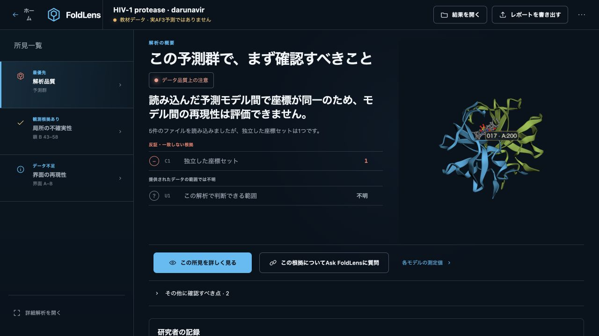
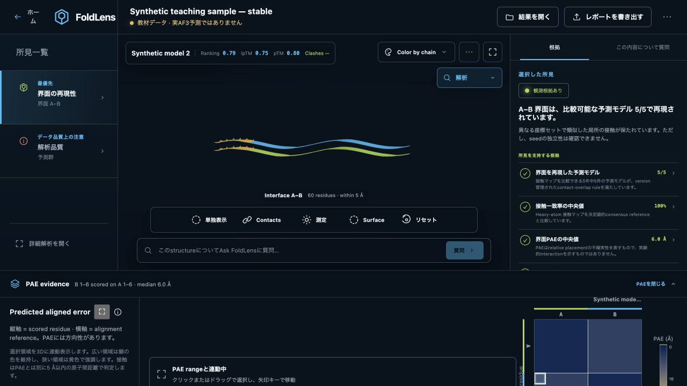
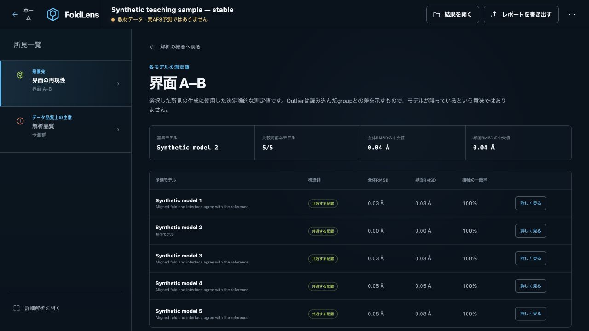
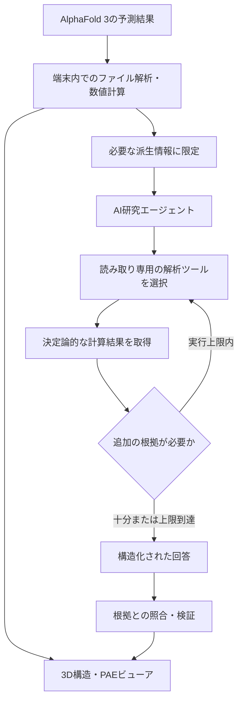

# FoldLens

日本語 | [English](README.en.md)

**タンパク質の構造予測結果を、根拠をたどれる科学的な解析へ。**

FoldLensは、AlphaFold 3の予測結果を研究者が解釈・比較・検証するためのローカルファーストな研究支援ワークスペースです。分子構造の3D可視化、予測信頼度、複数モデルの比較、計算結果を根拠として回答するAIエージェントを一つの画面に統合します。

薬学・生命科学とAIの接点に関心を持ち、OpenAI Build Week 2026のWork & Productivity部門向けに開発を始めました。その後、科学的な所見の追跡、macOSアプリ、Webサービスの設計、AIの利用コスト管理へと開発範囲を広げています。

[初期版の公開ソースコード](https://github.com/Shunsuke-max/foldlens) · [macOSアプリの配布ページ](https://github.com/Shunsuke-max/foldlens-releases/releases)

*2026年9月9日の実装監査時の画面。教材として実験構造PDB 4HLAと例示用の信頼度を使用しており、独立したAlphaFold予測の比較ではありません。*

## 1. 開発背景 — 予測結果を得ることと、理解することは異なる

AlphaFoldのような構造予測モデルは、生命科学研究に新しい可能性をもたらしています。一方、予測された立体構造が得られても、どの部分を信頼できるか、タンパク質同士の界面が妥当か、複数の予測で共通する特徴は何かを判断するには、研究者自身による解析が必要です。

従来のレビューでは、分子ビューア、信頼度のJSONファイル、PAEヒートマップ、複数の予測構造などを行き来することがあります。また、汎用LLMに予測結果を説明させるだけでは、数値の根拠や科学的な主張の妥当性を確認できない場合があります。

そこで、**予測結果を表示するだけでなく、何を確認すべきかを整理し、判断の根拠までたどれる環境を作る**ことを目標にしました。

対象は、構造予測を研究に利用する研究者や学生です。構造予測そのものを行うモデルではなく、予測後の科学的なレビューを支援するソフトウェアとして位置づけています。

## 2. プロダクトの主要機能

| 機能 | 内容 |
| --- | --- |
| 分子構造の可視化 | 3D構造、鎖・残基の選択、分子表面、リガンドの確認、距離測定 |
| 信頼度の解析 | pLDDT、pTM、ipTM、PAE、ランキングスコアなどを統合 |
| 複数モデルの比較 | 原子間接触、構造の差異、界面の整合性を評価 |
| AI研究エージェント | 質問に応じた解析ツールの選択、計算結果の取得、根拠付き回答 |
| 研究レビューの管理 | 所見、研究者のメモ、セッション保存、HTMLレポート |
| ローカルファースト | 元の分子構造ファイルを端末側で処理し、AIには必要な派生情報のみを送信 |

## 3. 実際の利用イメージ

以下は2026年9月9日の実装監査時に撮影した画面です。研究レビューの流れを示すものであり、ライブAIの性能評価ではありません。

### STEP 1 — 所見と根拠を確認する

解析で得られた所見を、対象となる分子領域、測定値、PAE行列と関連づけて表示します。研究者はAIに解釈を求める前に、どのデータが判断の根拠になっているかを確認できます。

### STEP 2 — 複数の予測モデルを比較する

モデルごとのRMSDや接触の一致率などを比較し、単一の信頼度スコアだけに依存しないレビューを支援します。

画面内の数値は人工的な教材データに基づくものであり、実際の予測精度や臨床的・実験的な有効性を示すものではありません。

### STEP 3 — 判定の前提を確認する

所見の生成に用いた解析方法や閾値を明示します。研究者が判定を鵜呑みにせず、その前提を検討できるようにしています。これらは初期の経験的なルールであり、実データを用いた専門家による校正は今後の課題です。

[初期版（2026年7月）の画面](https://github.com/Shunsuke-max/foldlens/blob/main/docs/audit-2026-07-21/06-desktop-workspace-fresh.png)

## 4. AIエージェントの設計

### LLMに計算を任せず、計算結果に基づいて考えさせる

科学的な解析では、自然な文章が生成されることと、数値や判断が正しいことは別の問題です。FoldLensでは、決定論的な解析処理とLLMによる解釈を分離しています。

エージェントは研究者の質問に応じて、全体の信頼度、鎖間界面、不確実な領域、選択されたPAE領域、予測間の指標比較、界面の整合性比較という6種類の読み取り専用解析ツールから必要なものを選択します。

各ツールの観測結果をもとに次の解析を選び、上限のあるAction–Observationループを通じて回答をまとめます。最終回答に含まれる測定値や根拠の参照先は、実際の解析データに照合されます。研究者はResearch pathから選択された解析とその観測結果を確認できます。

ライブAIが利用できない場合には、決定論的なローカル解析へ切り替え、その旨を明示する設計にしています。

### 科学的信頼性のための意思決定

| 設計上の判断 | 理由 |
| --- | --- |
| 原データを端末側で処理 | 未公開の研究データを不必要に外部へ送信しないため |
| 数値計算と文章生成を分離 | 測定値を実データに対応づけ、追跡できるようにするため |
| エージェントの行動範囲を制限 | 解析過程の透明性と計算コストの管理を両立するため |
| 予測信頼度と実験的な妥当性を区別 | 高いスコアや接触の一致を、生物学的機能や結合の証明と誤認しないため |
| 不確実性や反証となる条件を明示 | 結論だけではなく、判断の限界を伝えるため |

## 5. プロトタイプからプロダクトへの発展

初期版では、AlphaFold 3の出力を一つの画面でレビューし、根拠付きのAI回答を得る体験を中心に開発しました。その後、複数モデルの科学的な比較や、研究者の継続的な利用を想定した機能へと拡張しています。

| 領域 | 初期版 | 現在の開発 |
| --- | --- | --- |
| AI | 根拠付きの構造化回答 | ツールを選択する研究エージェントと観測過程の表示 |
| 科学的解析 | 信頼度・PAEの確認 | 原子間接触、界面の整合性、所見の追跡 |
| 提供形態 | Webワークスペース | Webサービス構成とmacOSアプリ |
| サービス設計 | 基本的なAPI利用制限 | 認証、利用枠、クレジット、課金基盤 |
| 品質管理 | パーサー・UIの回帰テスト | 解析の検証、ベンチマーク、配布時の検証フロー |

## 6. 事業化を意識したサービス設計

AIを組み込んだ研究支援ツールを継続的に提供するには、モデルの性能だけではなく、利用者ごとの原価や運用コスト、利用体験も考える必要があります。

FoldLensでは、解析モードごとの計算量と利用枠、クレジットの予約・確定、ユーザー認証、サブスクリプション課金、利用量制限を設計・実装しています。

ここでの価格設定や原価の想定は検証すべき事業仮説です。実際の利用量やトークンコストを計測して評価する必要があり、現時点で売上や有料ユーザーの獲得を実績として主張するものではありません。Web版のライブAI・認証・課金は、構成済み環境での検証が残っています。

## 7. 技術スタック

| 領域 | 技術 |
| --- | --- |
| フロントエンド | React、TypeScript、Vite、3Dmol.js |
| バックエンド・AI | Express、OpenAI Responses API、Zod |
| 認証・課金基盤 | Supabase、Stripe |
| デスクトップ | Electron、Electron Forge |
| テスト・配信 | Vitest、TypeScript、Vercel、Render |

## 8. 自身の役割とAIを活用した開発

FoldLensを通じて取り組んだのは、単に既存のAIをアプリに組み込むことではなく、生命科学研究において何が価値のある情報なのか、どこまでAIに判断を委ねられるのかを考え、プロダクトとして具体化することです。

開発ではCodexを設計・実装・テスト・改善のパートナーとして活用しました。自身が重視した意思決定は、原データを端末に残すこと、AI回答を計算された根拠に結びつけること、科学的に断定できない領域を定義すること、見栄えのよい回答よりも不確実性の明示を優先することです。

薬学・生命科学の学びを起点に、研究課題の発見から技術選定、ユーザー体験、運用・事業設計までを一つのプロダクトとして考える経験になっています。

## 9. 現在の到達点と課題

- macOS版はローカル解析と保存に対応する設計です。ライブAI・認証・課金はWeb版の機能で、構成済み環境での検証が残っています。
- 自動テストやベンチマークの仕組みは実装済みですが、本ポートフォリオでは独立に検証したテスト通過率や性能向上、利用者数、売上を主張していません。
- 原子間接触の一致は幾何学的な指標であり、結合エネルギーや生物学的相互作用の証明ではありません。また、座標が異なることは独立した予測seedの証明ではありません。
- 経験的な判定閾値は実際のAlphaFold 3予測結果と専門家の評価を用いた校正が必要です。
- FoldLensは構造予測、ドッキング、臨床判断、実験的検証を行うツールではありません。

今後は研究者によるレビュー体験の評価、実データを用いた科学的所見の校正、AI回答の根拠の妥当性、解析モード別の原価と課金ライフサイクルの検証を進めたいと考えています。

## 10. 公開範囲・帰属

本リポジトリはプロダクトおよび技術開発の紹介用です。初期版のソースコードは公開していますが、現在の開発コードは非公開です。

FoldLensは独立したプロジェクトであり、AlphaFoldの公式製品ではありません。AlphaFold Serverの出力には[適用される利用条件](https://alphafoldserver.com/output-terms)があります。教材に使用した実験構造は[RCSB PDB 4HLA](https://www.rcsb.org/structure/4HLA)です。例示用の信頼度は実際のAlphaFold予測結果ではありません。分子構造の描画には[3Dmol.js](https://3dmol.org/)を使用しています。
