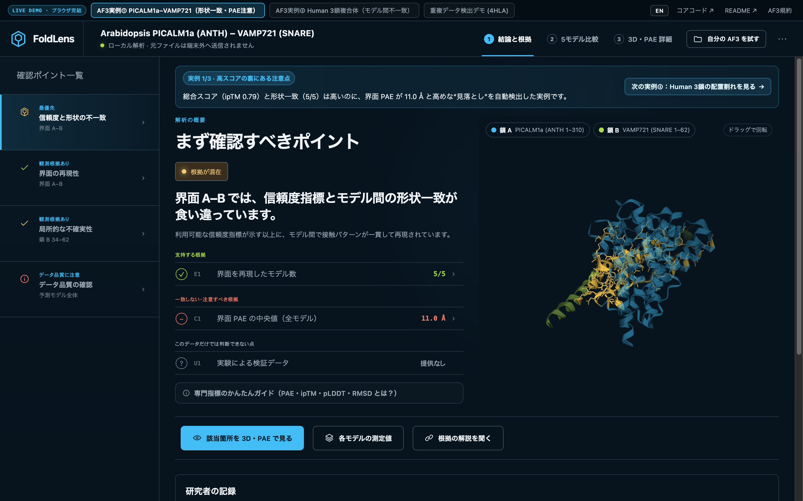
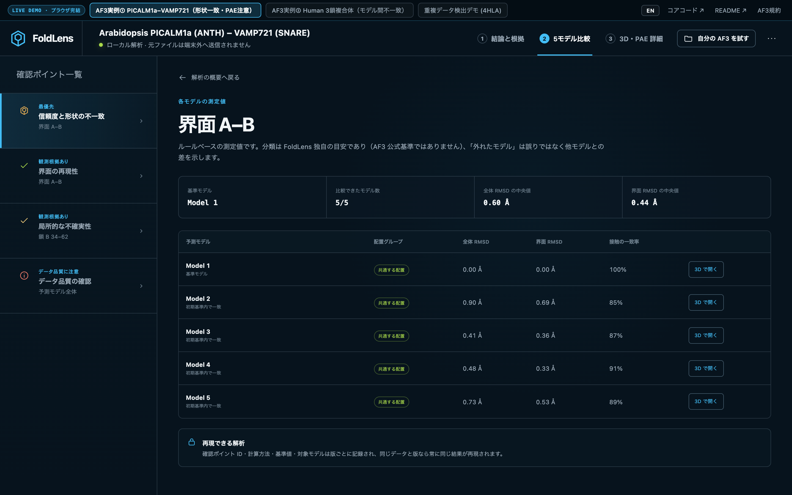
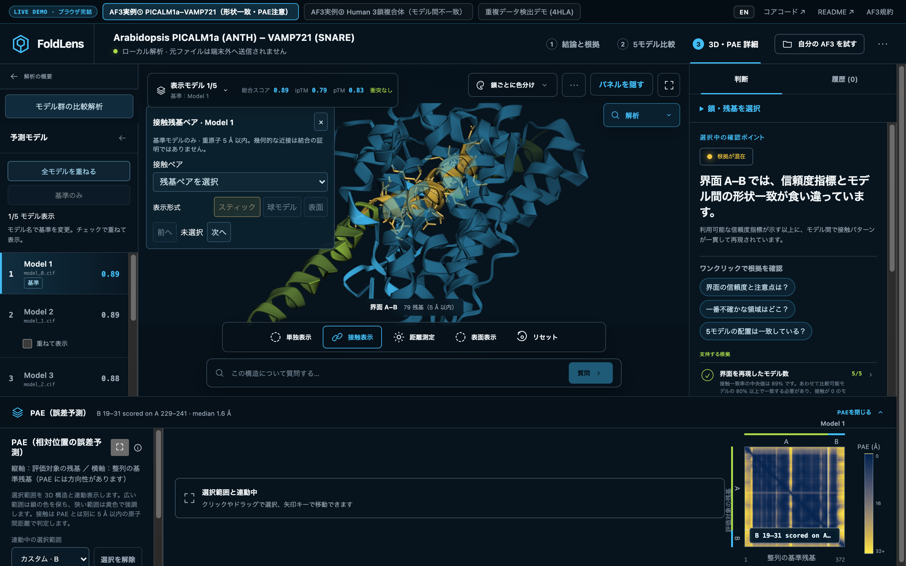
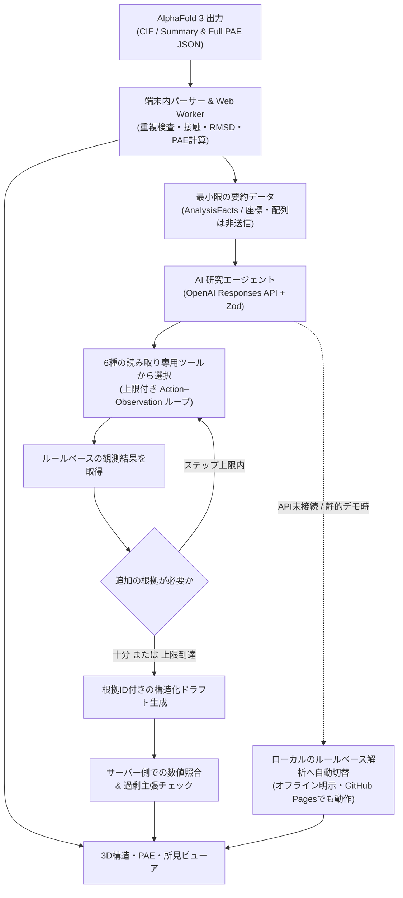

# FoldLens

日本語 | [English](README.en.md)

**AlphaFold 3 の構造予測結果を、データ品質チェックと厳密な数値根拠にもとづいて検証できる研究ワークスペース。**

[-0ea5e9?style=for-the-badge)](https://shunsuke-max.github.io/foldlens-portfolio/)
[-22c55e?style=flat-square)](https://github.com/Shunsuke-max/foldlens-core)

[-6366f1?style=flat-square)](https://shunsuke-max.github.io/foldlens-portfolio/?case=4hla)

> **▶ [ライブデモをブラウザで開く（インストール不要・APIキー不要・ブラウザ内完結）](https://shunsuke-max.github.io/foldlens-portfolio/)**  
> 実際の AlphaFold 3 Server で出力した予測データ 2 件（各 5 モデル）と重複座標チェック用データ（4HLA）を搭載しています。ブラウザ内の Web Worker で CIF / PAE JSON を直接解析するため、お手元の AF3 ZIP を試してもファイルは外部へ一切送信されません。
>
> **30 秒で全体像をつかむ体験ルート**
> 1. **実例 1/3（初期画面）**：上部の見どころガイドと **`1. 結論と根拠` → `2. 5モデル比較` → `3. 3D・PAE 詳細`** の 3 ステップタブを順にクリックし、高スコア（`ipTM 0.79`）の裏にある界面 PAE `11.0 Å` とワンクリック質問を確認する。
> 2. **実例 2/3（Human 3 鎖）**：ガイド右の「次の実例②」ボタンから切替え、配置割れ（`全体 RMSD 60.3 Å`）の自動警告と天然変性領域（`鎖 A 172–562`）の切り分けを見る。
> 3. **実例 3/3（重複座標 4HLA）**：「次の実例③」ボタンで、同一座標 5 ファイルを `0.001 Å` 精度で自動ブロックするデータ品質ゲートを確認する（右上 `EN / 日本語` で即時言語切替に対応）。

FoldLens は、AlphaFold 3 の構造予測結果を研究者が解釈・比較・検証するための**ローカル完結型（ローカルファースト）の AI 研究支援ワークスペース**です。3D 分子ビューア、信頼度・PAE 解析、複数予測モデル間の形状・接触比較、そして数値計算ツールを呼び出して根拠付きで回答する AI 研究エージェントをひとつの画面に統合しています。

薬学・生命科学とデータサイエンス／AI の接点から着想し、OpenAI Build Week 2026（Work & Productivity 部門）向けに初期版を開発しました。その後、重複座標の自動検出などのデータ品質チェック、ルールを版管理した自動所見エンジン、ツール選択型 AI エージェント、macOS デスクトップアプリ、さらに認証・従量課金を備えた Web サービス構成へと拡張しています。

[▶ ライブデモ（GitHub Pages）](https://shunsuke-max.github.io/foldlens-portfolio/) · [**コア実装・テスト（foldlens-core）**](https://github.com/Shunsuke-max/foldlens-core) · [macOS アプリ配布](https://github.com/Shunsuke-max/foldlens-releases/releases) · [初期版アーカイブ（v1）](https://github.com/Shunsuke-max/foldlens)

> **創薬・構造研究における設計上の3つの要点**
> 1. **未公開データを外に出さない（ローカルファースト）**：元の CIF / PAE JSON・原子座標・配列は端末内（ブラウザ／Web Worker）で処理し、LLM には座標から算出した最小限の要約指標（スコア・接触数など）のみを送信します。
> 2. **データ品質チェックと数値計算の分離**：複数モデルを比較する前に重複ファイルがないかを自動検査し、接触一致率（Jaccard 係数）・界面 RMSD・両方向 PAE などの定量指標を、LLM とは切り離したルールベース計算（決定論的計算）で算出します。
> 3. **根拠をたどれる AI 研究エージェント**：6 種類の読み取り専用解析ツールを上限付きループで呼び出し、回答内の数値や根拠参照をすべてサーバー側で実データと照合・検証します。

*実際の AlphaFold 3 Server 出力（`Arabidopsis PICALM1a ANTH – VAMP721 SNARE`・5モデル）をブラウザ内のルールベースエンジンで解析した画面。5/5 モデルで界面の接触パターンが一致する一方、界面 PAE（相対位置の誤差予測）の中央値が 11.0 Å であることを自動検知し、「信頼度指標と形状比較の不一致」を最優先の確認ポイントとして提示しています。*

---

## 1. 実際の AlphaFold 3 データによるケーススタディ（安定例 vs 不一致例の対比）

総合スコア（`ranking_score` や `ipTM`）だけを見て判断すると見落としやすいポイントを、公開されている野生型配列に対する**実際の AlphaFold 3 Server 出力 2 件（各 5 モデル・独立座標 5/5）**で検証しました。いずれも [ライブデモ](https://shunsuke-max.github.io/foldlens-portfolio/) 上部バーから 1 クリックで切り替えて確認できます。

### 2 件の定量比較（FoldLens 自動解析エンジンの実出力）

| 評価項目 | Case 1：Arabidopsis PICALM1a (ANTH) – VAMP721 (SNARE) （[ライブデモで開く](https://shunsuke-max.github.io/foldlens-portfolio/?case=vamp721)） | Case 2：Human PICALM – HRB – VAMP7 （[ライブデモで開く](https://shunsuke-max.github.io/foldlens-portfolio/?case=human)） |
| :--- | :--- | :--- |
| **構成・モデル数** | 2 鎖（310 aa + 62 aa）・5 モデル（独立座標 5/5） | 3 鎖（562 aa + 652 aa + 220 aa）・5 モデル（独立座標 5/5） |
| **AF3 総合スコア範囲** | `ranking_score`: `0.88–0.89` / `pTM`: `0.83` / `ipTM`: `0.79` | `ranking_score`: `0.40–0.54` / `pTM`: `0.31–0.34` / `ipTM`: `0.20–0.24` |
| **全体 RMSD 中央値** | **`0.60 Å`**（範囲 `0.41–0.90 Å`） | **`60.33 Å`**（範囲 `58.84–62.47 Å`） |
| **界面 RMSD 中央値** | **`0.44 Å`**（範囲 `0.33–0.69 Å`） | **`25.36 Å`**（範囲 `23.50–26.85 Å`） |
| **重原子接触の一致率（Jaccard）** | 中央値 **`88–89%`**（範囲 `85%–91%`） | 中央値 **`40%`**（Model 3 は **`13%`** まで低下） |
| **最優先の確認ポイント（自動判定）** | **`confidence_geometry_conflict`（根拠が混在）** 界面は `5/5` モデルで再現されるが、界面 PAE 中央値が `11.0 Å`（初期基準 `10 Å` を超過） | **`analysis_quality`（データ品質上の注意）** 過半数を占める安定した配置なし（最大群 `1/5`）。単一モデルの採用リスクを警告 |
| **局所的に不確実な領域の特定** | **Chain B 34–62**（平均 pLDDT `49`・very low、界面と重複） | **Chain A 172–562**（平均 pLDDT `29`・very low、PICALM の長い天然変性領域） |
| **分析上のポイント** | `ipTM 0.79` の高さだけで結論づけず、SNARE 後半部の柔軟性と PAE の高さを優先確認すべきことが明確になる | 鎖ペアごとの分解により、A–C が `3/5`（`ipTM 0.47–0.49`）と `2/5`（`0.12–0.13`）に分かれる乖離と変性領域の影響を切り分けられる |

---

### Case 1：高スコア複合体でも「形状の一致」と「誤差予測（PAE）・局所的な不確実性」を分けて確認する

植物のエンドサイトーシスに関わる PICALM1a（ANTH ドメイン）と VAMP721（SNARE モチーフ）の複合体（[VAMP721–PICALM1a 構造アンサンブル解析リポジトリ](https://github.com/Shunsuke-max/vamp721-structural-ensemble) と同じ分子系）に対する実 AF3 出力です。

#### ① モデル間の形状・接触比較（5モデルすべてで界面がよく一致）

全 5 モデルで `ranking_score 0.88–0.89`・`ipTM 0.79`、全体 RMSD 中央値 `0.60 Å`、界面 RMSD 中央値 `0.44 Å`、重原子接触の一致率 `85%–91%` と、モデル間の立体配置は非常に安定して一致しています。

#### ② 3D 構造・ドメインマップ・数値根拠の連動ワークスペース

一方で FoldLens は、**界面 PAE の中央値が `11.0 Å`（初期基準 `10 Å` を上回る）**点と、**VAMP721 側 34–62 残基の平均 pLDDT が `49`** と低く界面に重なっている点を自動で抽出します。「どの部分は堅牢に予測されており、どこに不確実性が残るか」を総合スコアの裏側から明らかにします。

---

### Case 2：天然変性領域（IDR）を含む 3 鎖複合体で、モデル間の配置割れを自動警告する

ヒトの PICALM・HRB（AGFG1）・VAMP7 の 3 鎖複合体（決まった立体構造をとらない天然変性領域を多く含み、`fraction_disordered 0.55–0.56`）に対する実 AF3 出力です。

* **モデル間の配置がまとまっていないことを自動警告**：似た配置をとるモデルが最大でも `1/5` にとどまるため、FoldLens は「過半数を占める安定した配置が見つからなかった」という品質警告を最優先で表示します。
* **鎖ペアごとの一致・不一致を分解**：A–C（PICALM–VAMP7）界面は Model 1/2/5 で `chain_pair_iptm 0.47–0.49` なのに対し、Model 3/4 では `0.12–0.13` へ急落します（界面再現 `3/5`・接触一致率中央値 `52%`）。また A–B 界面は `1/5`（一致率 `0%`）と不安定であることを定量的に切り分けます。
* **天然変性領域（IDR）の自動特定**：Chain A 172–562（平均 pLDDT `29`）を局所的に不確実な領域として自動抽出し、全体 RMSD が `60.33 Å` まで大きくなる構造上の要因を可視化します。

---

## 2. 課題背景とデータ品質チェック（ルールベース指標の設計）

AlphaFold 3 などの構造予測モデルは生命科学・創薬研究を大きく前進させましたが、予測結果を得た後の実務レビューには次の課題が残ります。

* **判断材料の分断**：分子ビューア、信頼度 JSON（pLDDT / pTM / ipTM）、PAE ヒートマップ、複数の予測モデルを行き来するうちに、どのスコアがどの鎖ペア・残基領域に対応するか追いにくくなる。
* **データ品質の見落とし**：同じ座標ファイルが重複して読み込まれていても、見かけ上「複数モデルで一致している」と誤認してしまうリスクがある。
* **汎用 LLM の信頼性不足**：汎用チャットボットに要約させるだけでは、数値の算出根拠・閾値の前提・予測が覆り得る条件（反証条件）を検証できない。

### データ品質ゲート（重複ファイルの自動検出）
複数モデルの再現性を評価する前に、**鎖 ID・残基番号ごとの主鎖座標を `0.001 Å` 単位で照合**し、本当に異なる構造データがいくつ含まれているかを検査します（回転・平行移動や同じ種類の鎖の入れ替えは同一データとみなしません）。ライブデモの [`重複データ検出デモ (4HLA)`](https://shunsuke-max.github.io/foldlens-portfolio/?case=4hla) では、同一座標の 5 ファイルに対して「モデル間再現性は評価できない」と自動ブロックする動きを確認できます。

重複データ検出ゲート・解析方法パネルの画面を見る（クリックで展開）

*同一座標 5 ファイル（教材データ PDB 4HLA）を読み込んだ際、重複座標を自動検出してモデル間再現性の評価を止める様子。*

*所見の根拠となった距離カットオフ・Jaccard 係数・RMSD 閾値、および未校正の初期基準である旨を画面上でいつでも確認可能。*

### 版管理されたルールベース指標（初期レビュー基準）

| ルール識別子 | 指標 | 初期閾値 | 役割と前提 |
| :--- | :--- | :---: | :--- |
| `interface-consensus-fraction-v1` | 界面が再現されるモデルの割合 | `0.8` | 複数モデル間で共通界面とみなす一致割合の初期基準 |
| `contact-cutoff-5a` | 重原子間の接触距離 | `5 Å` | ポリマー `ATOM` 重原子間の界面接触判定（リガンド・`HETATM` 除外） |
| `contact-jaccard-v1` | モデル間の接触一致率（Jaccard 係数） | `0.5` | 基準モデルとの重原子接触マップの重なり度合い |
| `interface-rmsd-v1` | 構造重ね合わせ後の界面 RMSD | `3 Å` | 局所的な界面配置のモデル間ばらつき |
| `global-rmsd-v1` | 複合体全体の主鎖 RMSD | `2.5 Å` | 複合体全体の立体配置の一致度 |
| `interface-pae-context-v1` | 両方向の界面 PAE | `10 Å` | PAE の方向性（A→B / B→A）を踏まえた誤差予測の目安 |

※上記は初期の経験的な基準であり、より多くの実 AlphaFold 3 予測データと専門家評価による校正（`calibrate_af3_corpus`）を今後の継続課題としています。

---

## 3. AI 研究エージェントのアーキテクチャ

### 「LLM に計算させず、数値計算ツールの観測結果をもとに説明させる」

### エージェントが使う 6 種類の読み取り専用解析ツール

| ツール名 | 役割（すべて読み取り専用・ルールベース計算） |
| :--- | :--- |
| `inspect_overall_confidence` | ランキングスコア、pTM、全体 ipTM、クラッシュ有無、信頼度データの有無を取得 |
| `inspect_interface` | 指定した鎖ペアの ipTM、両方向 PAE、低 PAE 割合、座標ベースの接触数を取得 |
| `find_uncertain_regions` | 局所 pLDDT が低い領域や、PAE 上で不確実性が高い領域を抽出 |
| `inspect_selected_region` | ユーザーが PAE ヒートマップ上で選んだ残基範囲の両方向 PAE 統計を取得 |
| `compare_predictions` | 読み込んだ複数の予測モデル間で指定指標を横断比較 |
| `compare_interface_consistency` | 信頼度指標と重原子接触の一致率から、モデル間の界面再現性を比較 |

### 科学的信頼性とセキュリティのための設計判断

| 設計判断 | 理由・狙い |
| :--- | :--- |
| **元データを端末内（Web Worker）で処理** | 未公開の創薬ターゲット配列・原子座標を外部 API へ送らないローカルファースト境界を徹底 |
| **数値計算と文章生成の厳密な分離** | 回答に載せる測定値・根拠カード・画面操作をサーバー側で実データから生成し、数値の捏造を防止 |
| **ステップ上限付きツールループ** | 解析過程の透明性（Research path）と、API コスト・応答時間の上限管理を両立 |
| **過剰主張の禁止と反証条件の強制** | Zod 構造化出力により、臨床効果や実験的結合の断定を禁止し、別の解釈や反証条件を必ず明示 |
| **オフライン自動フォールバック** | API 未接続環境（GitHub Pages 静的デモを含む）でも同一のデータ構造でローカル解析へ切替・明示 |

---

## 4. プロトタイプからプロダクトへの発展と技術スタック

| 領域 | 初期版（2026年7月・アーカイブ済み） | 現在の構成（公開コア `foldlens-core` ＋ 静的デモ ＋ 非公開製品本体） |
| :--- | :--- | :--- |
| **AI アーキテクチャ** | 根拠付き構造化回答（単発） | 6 ツール選択型研究エージェント＋思考・観測過程の表示＋オフライン切替 |
| **科学的解析** | 信頼度・PAE ビューア | 重複座標検出、重原子接触・Jaccard・界面 RMSD、Web Worker 非同期解析 |
| **提供形態** | Web ワークスペース | [GitHub Pages ライブデモ](https://shunsuke-max.github.io/foldlens-portfolio/) ＋ Web サービス構成 ＋ Electron macOS アプリ |
| **サービス・原価設計** | IP ベースの簡易レート制限 | 認証（Supabase）、解析モード別クレジット予約・確定、課金基盤（Stripe） |
| **品質管理・検証** | パーサー・UI の回帰テスト | パーサー・接触解析・エージェント評価・課金整合性の自動テスト、実データ校正（`calibrate_af3_corpus`）・ベンチマーク基盤 |

**技術スタック**：React 19 / TypeScript / Vite / 3Dmol.js / Web Workers / Express 5 / OpenAI Responses API / Zod 4 / Supabase / Stripe / Electron / Vitest

---

## 5. 自身の役割と AI 協調開発

FoldLens は「LLM をアプリに組み込むこと」自体が目的ではなく、**「生命科学の研究者が意思決定に使える情報設計とは何か」「AI に任せてよい推論と、プログラムの数値計算に固定すべき事実の境界はどこか」**をプロダクトとして検証した取り組みです。

開発では AI コーディングエージェント（Codex / Antigravity 等）を実装・テスト・リファクタリングのパートナーとして活用しつつ、以下の設計意思決定を一貫して主導しました。
* 未公開の分子構造・配列を外部送信しないローカルファースト境界の設計
* 重複座標検出や版管理されたルールベース指標によるデータ品質担保
* AI の出力を実データと照合し、反証条件と不確実性を隠さない科学的 UX の設計
* 解析モード別の計算原価・クレジット精算を見据えたサービスアーキテクチャ設計
* UI 文言・警告・ドキュメントをソフトウェアの品質特性として検証する UX ライティング運用（詳細：[設計ノート](docs/ux-writing-in-scientific-ai.md) · [8 項目チェックリスト](docs/ux-writing-checklist.md)）

---

科学的スコープ・利用規約・帰属表記（クリックで展開）

* **科学的限界**：重原子接触の一致率や RMSD は立体配置の幾何学的な指標であり、結合自由エネルギー・結合親和性・生物学的機能の証明ではありません。座標が異なることは独立した予測 seed の証明ではなく、経験的な判定閾値は実 AlphaFold 3 データと専門家による校正が必要です。また、FoldLens は構造予測・ドッキング・臨床判断・実験的検証を行うソフトウェアではありません。
* **ライブデモの公開構成**：[GitHub Pages ライブデモ](https://shunsuke-max.github.io/foldlens-portfolio/) は、サーバー・認証・課金・外部 LLM 通信およびソースマップを含まないブラウザ完結型の静的ビルドです。ファイル解析・モデル比較・オフライン応答はすべて端末内のみで実行されます。
* **AlphaFold Server 出力の利用条件**：本ポートフォリオおよびライブデモに含まれる実際の AlphaFold 3 予測データ 2 件（非商用ポートフォリオ展示用・Web 配信のため MSA およびテンプレート構造ファイルを省略し、モデル構造・信頼度 JSON は未改変で収録）は、[AlphaFold Server Output Terms of Use](https://alphafoldserver.com/output-terms)（非商用利用限定）の適用を受けます（規約全文の写しをライブデモ内 [`ALPHAFOLD_SERVER_TERMS_OF_USE.md`](https://shunsuke-max.github.io/foldlens-portfolio/samples/ALPHAFOLD_SERVER_TERMS_OF_USE.md) に同梱）。
* **帰属**：FoldLens は独立プロジェクトであり AlphaFold の公式製品ではありません。v0.2.8 の解析エンジン・AI エージェント・自動テストは [Shunsuke-max/foldlens-core](https://github.com/Shunsuke-max/foldlens-core) にて公開しています（認証・課金を含む製品本体は非公開運用・面接時のコード共有に対応。初期版 v1 は [Shunsuke-max/foldlens](https://github.com/Shunsuke-max/foldlens) にアーカイブ済み）。教材データには [RCSB PDB 4HLA](https://www.rcsb.org/structure/4HLA)、3D 可視化には [3Dmol.js](https://3dmol.org/) を使用しています。

