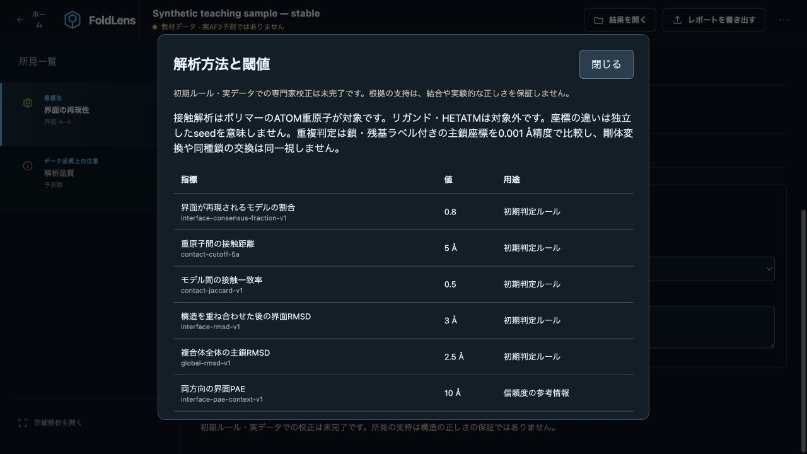
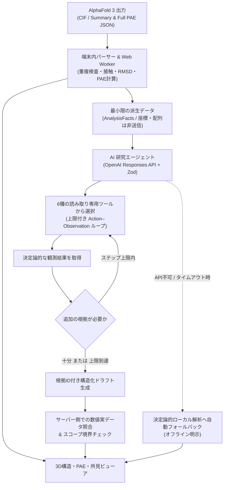

# FoldLens

日本語 | [English](README.en.md)

**AlphaFold 3 の構造予測結果を、データ品質チェックと決定論的な数値根拠に基づく科学的なレビューへ。**

FoldLens は、AlphaFold 3 の予測結果を研究者が解釈・比較・検証するための**ローカルファーストな AI 研究支援ワークスペース**です。3D 分子可視化、信頼度・PAE 解析、複数予測モデル間の幾何・接触比較、そして決定論的な解析ツールを呼び出して根拠付きで回答する AI 研究エージェントを単一の環境へ統合しています。

薬学・生命科学とデータサイエンス／AI の接点から着想し、OpenAI Build Week 2026（Work & Productivity 部門）向けに初期版を開発しました。その後、重複座標などのデータ品質チェック、バージョン管理された決定論的所見エンジン、ツール選択型 AI エージェント、macOS デスクトップアプリ、および従量課金・認証を備えた Web アーキテクチャへと拡張しています。

[初期版の公開ソースコード](https://github.com/Shunsuke-max/foldlens) · [macOS アプリ配布ページ](https://github.com/Shunsuke-max/foldlens-releases/releases)

> **創薬・構造研究における設計上の3つの要点**
> 1. **未公開構造の秘匿（ローカルファースト）**：元の CIF / PAE JSON・原子座標・配列は端末内（ブラウザ／Web Worker）で解析し、LLM には必要最小限の派生メトリクスのみを送信。
> 2. **データ品質ゲートと決定論的計算の分離**：複数モデルの比較前に重複座標を自動検出し、Jaccard 接触一致率・界面 RMSD・両方向 PAE などの定量指標を LLM から切り離して算出。
> 3. **監査可能な AI 研究エージェント**：6 種類の読み取り専用解析ツールを上限付きループで呼び出し、すべての数値・根拠参照をサーバー側で実データと照合・構造化検証。

*2026年9月9日の実装監査時の画面。教材として実験構造 [RCSB PDB 4HLA](https://www.rcsb.org/structure/4HLA) と例示用の信頼度を使用しており、独立した AlphaFold 3 予測の比較ではありません。5件のファイルで座標が同一であることを自動検出し、「モデル間再現性は評価不可」とデータ品質上の警告を提示しています。*

---

## 1. 課題背景 — 「構造が予測できること」と「科学的に判断できること」は異なる

AlphaFold 3 などの構造予測モデルは生命科学・創薬研究を大きく前進させましたが、予測構造を得た後の実務レビューには依然として複数の課題が残ります。

* **判断材料の分断**：分子ビューア、信頼度 JSON（pLDDT / pTM / ipTM）、PAE ヒートマップ、複数の予測モデルを行き来するうちに、どのスコアがどの鎖ペア・残基領域に対応するのか追跡しにくくなる。
* **データ品質の見落とし**：同一座標ファイルが重複していても、見かけ上「複数モデルで一致」と誤認してしまうリスクがある。
* **汎用 LLM の信頼性不足**：汎用チャットボットに予測結果を要約させるだけでは、数値の算出根拠・閾値の前提・科学的な反証条件を検証できない。

FoldLens は構造予測そのものを行うツールではなく、**「何から確認すべきか」「どの数値が根拠か」「どこまでが予測の限界か」を体系的に検証できるレビュー基盤**として設計しています。

---

## 2. 決定論的な定量解析とデータ品質チェック

FoldLens では、AI が文章を生成する前に、まず端末内の決定論的パイプラインで構造データと信頼度指標を解析します。

### データ品質ゲート（重複座標の自動検出）
複数モデルの再現性を評価する前に、**鎖・残基ラベル付きの主鎖座標を 0.001 Å 精度で比較**し、独立した座標セット数を検査します（剛体変換や同種鎖の交換は同一視しません）。座標が重複している場合は「再現性は評価できない」と明示的に警告します。

### バージョン管理された決定論的メトリクス（初期レビュー規則）
所見の生成に用いる指標・閾値はすべて識別子付きで明示し、研究者がブラックボックスを鵜呑みにせず前提を検討できるようにしています（下図はアプリ内の「解析方法と閾値」パネル）。

| ルール識別子 | 指標 | 初期閾値 | 設計上の役割・前提 |
| :--- | :--- | :---: | :--- |
| `interface-consensus-fraction-v1` | 界面が再現されるモデルの割合 | `0.8` | 複数モデル間で共通界面とみなす一致割合の初期規則 |
| `contact-cutoff-5a` | 重原子間の接触距離 | `5 Å` | ポリマー `ATOM` 重原子間の界面接触判定（リガンド・`HETATM` 除外） |
| `contact-jaccard-v1` | モデル間の接触一致率（Jaccard 係数） | `0.5` | 基準モデルとの重原子接触マップ重複度の定量評価 |
| `interface-rmsd-v1` | 構造重ね合わせ後の界面 RMSD | `3 Å` | 局所的な界面配置のモデル間ばらつき評価 |
| `global-rmsd-v1` | 複合体全体の主鎖 RMSD | `2.5 Å` | 複合体全体のコンフォメーション一致度の評価 |
| `interface-pae-context-v1` | 両方向の界面 PAE | `10 Å` | PAE の方向性（A→B / B→A）を考慮した信頼度コンテキスト |

※上記は初期の経験的ルールであり、実 AlphaFold 3 予測データと専門家評価による校正は今後の課題として位置づけています。

---

## 3. 実際のレビューフロー（実装画面）

以下は 2026年9月9日の実装監査時の画面です（教材データを用いた UI・解析フローの動作例であり、ライブ AI の精度評価ではありません）。

### STEP 1 — 所見・3D構造・PAE 行列を根拠単位で連動確認する

選択した所見に対して、対象の分子領域・接触一致率・界面 PAE 中央値・PAE ヒートマップ（方向性の説明付き）を連動表示します。研究者は AI に質問する前に一次データ上の根拠を確認できます。

### STEP 2 — 単一スコアに頼らず、複数モデルの幾何・接触を比較する

基準モデルに対する各予測の全体 RMSD・界面 RMSD・接触一致率を一覧化し、単一のランキングスコアや ipTM だけに依存しない多角的なレビューを支援します（Outlier は群との差を示すものであり、誤りの断定ではない旨を明記）。

### STEP 3 — 判定ロジックと閾値の前提をいつでも監査できる

所見の根拠となった距離カットオフ・Jaccard 係数・RMSD 閾値・対象原子の範囲・未校正である旨を UI 上で透過的に確認できます。

[初期版（2026年7月）の画面を見る](https://github.com/Shunsuke-max/foldlens/blob/main/docs/audit-2026-07-21/06-desktop-workspace-fresh.png)

---

## 4. AI 研究エージェントのアーキテクチャ

### 「LLM に計算させず、決定論的ツールの観測結果に基づいて推論させる」

### エージェントが利用する 6 種類の読み取り専用解析ツール

エージェントは質問意図に応じて必要なツールだけを選択し、研究者は **Research path** から実行履歴と観測結果を確認できます。

| ツール名 | 役割（すべて読み取り専用・決定論的） |
| :--- | :--- |
| `inspect_overall_confidence` | ランキングスコア、pTM、全体 ipTM、クラッシュ有無、信頼度データの利用可否を取得 |
| `inspect_interface` | 指定鎖ペアの ipTM、両方向 PAE、低 PAE 割合、座標ベースの接触数を取得 |
| `find_uncertain_regions` | 局所 pLDDT が低い領域や PAE 上で不確実性の高い領域を抽出 |
| `inspect_selected_region` | ユーザーが PAE 行列上で選択した残基範囲の両方向 PAE 統計を取得 |
| `compare_predictions` | 読み込んだ複数予測モデル間で選択メトリクスを横断比較 |
| `compare_interface_consistency` | 信頼度支持と重原子接触重複率から、複数モデル間の界面一貫性を比較 |

### 科学的信頼性とセキュリティのための設計判断

| 設計判断 | 理由・狙い |
| :--- | :--- |
| **原データを端末内（Web Worker）で処理** | 未公開の創薬ターゲット配列・立体座標を外部 API へ送信しないローカルファースト境界の徹底 |
| **数値計算と自然言語生成の厳密な分離** | 回答に含まれる測定値・根拠カード・ビューア操作をサーバー側で実データから生成し、数値捏造を防止 |
| **ステップ上限付きツールループ** | 解析プロセスの透明性（Research path）と API 計算コスト・レイテンシの上限管理を両立 |
| **反証条件・代替解釈・スコープ境界の強制** | Zod 構造化出力により、臨床有効性・投薬・in vivo 結合などの過剰主張を禁止し、不確実性を明示 |
| **決定論的ローカルフォールバック** | API キー未設定・制限・タイムアウト時も同一レスポンス構造でオフライン解析へ切替・明示 |

---

## 5. プロトタイプからプロダクトへの発展と検証基盤

| 領域 | 初期版（2026年7月・公開） | 現在の開発（非公開リポジトリ） |
| :--- | :--- | :--- |
| **AI アーキテクチャ** | 根拠付き構造化回答（単発） | 6ツール選択型研究エージェント＋観測過程（Research path）表示 |
| **科学的解析** | 信頼度・PAE ビューア | 重複座標検出、重原子接触・Jaccard・界面 RMSD、Web Worker 非同期解析 |
| **提供形態** | Web ワークスペース | Web サービス構成 ＋ Electron 製 macOS デスクトップアプリ |
| **サービス・原価設計** | IP ベースの簡易レート制限 | 認証（Supabase）、解析モード別クレジット予約・確定、課金基盤（Stripe） |
| **品質管理・検証設計** | パーサー・UI の回帰テスト | パーサー・接触解析・エージェント評価・課金整合性の自動テスト群、実データ校正スクリプト（`calibrate_af3_corpus`）、解析ベンチマーク基盤（`benchmark_analysis`） |

### 技術スタック

| レイヤー | 主な技術 |
| :--- | :--- |
| **フロントエンド・可視化** | React 19, TypeScript, Vite, 3Dmol.js, Web Workers |
| **バックエンド・AI** | Express 5, OpenAI Responses API, Zod 4 |
| **認証・課金・保護** | Supabase, Stripe, Turnstile, レート制限・暗号化ユーティリティ |
| **デスクトップ・配信** | Electron, Electron Forge, Vercel, Render |
| **テスト・検証** | Vitest, Testing Library, TypeScript (`tsc --noEmit`) |

---

## 6. 自身の役割と AI 協調開発

FoldLens は「LLM をアプリに組み込むこと」自体が目的ではなく、**「生命科学の研究者が実際に意思決定に使える情報設計とは何か」「AI に任せてよい推論と、決定論的計算に固定すべき事実の境界はどこか」**をプロダクトとして検証した取り組みです。

開発では Codex を設計・実装・テスト・リファクタリングのパートナーとして活用しつつ、以下のコア意思決定を一貫して主導しました。
* 未公開の分子構造・配列を外部送信しないローカルファースト境界の設計
* 重複座標検出やバージョン管理された決定論的ルールによるデータ品質担保
* LLM の出力を実データと照合し、反証条件と不確実性を隠さない科学的 UX の設計
* 解析モード別の計算原価・クレジット精算を見据えた持続可能なサービスアーキテクチャ設計

---

## 7. 科学的スコープ・到達点・公開範囲

* **科学的限界**：重原子接触の一致や RMSD は幾何学的な指標であり、結合自由エネルギー・結合親和性・生物学的機能の証明ではありません。座標が異なることは独立した予測 seed の証明ではなく、経験的な判定閾値は実 AlphaFold 3 データと専門家による校正が必要です。また、FoldLens は構造予測・ドッキング・臨床判断・実験的検証を行うソフトウェアではありません。
* **現在の到達点と検証状況**：macOS 版はローカル解析・保存に対応する設計であり、ライブ AI・認証・課金は Web 版機能として構成済み環境での結合検証を残しています。自動テスト・ベンチマーク・課金・原価設計の仕組みは実装済みですが、本ポートフォリオでは独立検証済みのテスト通過率・性能向上率・利用者数・売上を実績として主張しません。
* **今後の優先課題**：実 AlphaFold 3 予測コーパスを用いた専門家との閾値校正、研究者によるレビュー体験・根拠妥当性の評価、解析モード別のトークン原価と課金ライフサイクルの実測検証。
* **公開範囲・帰属**：本リポジトリはポートフォリオ紹介用です（初期版は [Shunsuke-max/foldlens](https://github.com/Shunsuke-max/foldlens) にて公開、現在の開発コードは非公開）。FoldLens は独立プロジェクトであり AlphaFold の公式製品ではありません。AlphaFold Server の出力には[適用される利用条件](https://alphafoldserver.com/output-terms)があり、教材データには [RCSB PDB 4HLA](https://www.rcsb.org/structure/4HLA) および [3Dmol.js](https://3dmol.org/) を使用しています。
