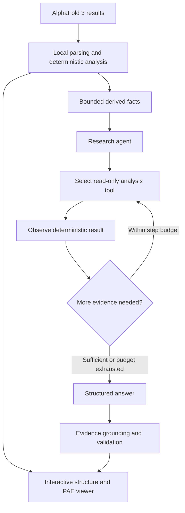

# FoldLens

**From protein structure predictions to evidence-linked scientific review.**

FoldLens is a local-first research workspace for interpreting AlphaFold 3 results. It brings molecular visualization, prediction confidence, cross-model comparison, and a tool-using AI research agent into one interface.

Originally built for the Work & Productivity track of OpenAI Build Week 2026, FoldLens has evolved into a broader research software project with a macOS application, a web architecture, and a metered AI service design.

[Original public repository](https://github.com/Shunsuke-max/foldlens) · [macOS releases](https://github.com/Shunsuke-max/foldlens-releases/releases)

## The problem

A structure prediction is not the same as experimental evidence. Reviewing a prediction requires moving between molecular coordinates, confidence scores, predicted aligned error (PAE), multiple predicted models, and biological context. These artifacts can be difficult to interpret together, and a fluent AI explanation alone cannot establish scientific validity.

FoldLens was designed to make this review process more coherent, traceable, and reproducible.

## Core capabilities

| Capability | What FoldLens provides |
| --- | --- |
| Molecular visualization | Interactive 3D structures, chain and residue selection, surfaces, ligand inspection, and measurements. |
| Confidence analysis | Integrated pLDDT, pTM, ipTM, PAE, ranking scores, and predicted-region review. |
| Cross-model comparison | Deterministic heavy-atom contact analysis and interface consistency across distinct coordinate predictions. |
| Research agent | Goal-directed selection of read-only analysis tools, observation of results, and structured synthesis with evidence references. |
| Review workflow | Research paths, evidence-linked viewer actions, researcher notes, saved sessions, and HTML reports. |
| Local-first processing | Molecular files are parsed locally; the AI receives bounded derived facts rather than source coordinates or sequences. |

## How the research agent works

Rather than asking an LLM to invent scientific measurements, FoldLens separates the numerical analysis from the interpretation. The agent can choose among six bounded analysis tools, including overall confidence inspection, chain-pair interface inspection, uncertain-region discovery, selected PAE-region inspection, cross-model metric comparison, and interface consistency comparison.

The server resolves measurements and evidence references from deterministic facts and validates the final structured response. The research path is visible to the user. If the live AI service is unavailable, a local analyzer provides a clearly labelled fallback.

## Key design decisions

| Decision | Rationale |
| --- | --- |
| Keep source molecular data local | Reduce unnecessary transfer of potentially sensitive research data. |
| Separate calculation from language generation | Keep numeric findings traceable to the underlying data. |
| Bound the agent's actions | Make the research path inspectable and limit unnecessary computation. |
| Distinguish geometric consistency from biological validity | Avoid presenting contact overlap or confidence as evidence of binding, function, or clinical efficacy. |
| Preserve scientific caveats in the UI and exports | Make uncertainty part of the review rather than an afterthought. |

## From prototype to product

| Area | Original project | Current development |
| --- | --- | --- |
| AI | Structured, evidence-linked analysis | Tool-using research agent with visible observations |
| Scientific review | Confidence metrics and PAE | Coordinate-contact analysis, cross-model consistency, and review provenance |
| Delivery | Web workspace | Web architecture and local macOS application |
| Service design | Basic API limits | Account identity, metered credits, usage limits, and subscription infrastructure |
| Quality | Parser and UI regression coverage | Expanded tests, analysis benchmarking, and desktop release validation workflows |

The service design includes distinct analysis modes, credit reservation and settlement, account authentication, subscription billing, and controls for AI usage. Pricing and cost assumptions are hypotheses to evaluate against real usage, not evidence of commercial traction.

## Technology

| Layer | Tools |
| --- | --- |
| Interface | React, TypeScript, Vite, 3Dmol.js |
| AI and server | OpenAI Responses API, Express, Zod |
| Account and billing infrastructure | Supabase, Stripe |
| Desktop | Electron, Electron Forge |
| Testing and delivery | Vitest, TypeScript checks, Vercel, Render |

## My contribution

I approach FoldLens as both a scientific software project and a product design problem. I used Codex as an iterative engineering and design partner. My key decisions include keeping molecular files local, grounding AI explanations in deterministic evidence, defining scientific scope boundaries, and prioritizing transparent limitations over impressive but misleading demonstrations.

The project connects my interests in pharmacy, computational biology, AI agents, and building useful software. The original implementation is public; the current development source is kept private.

## Current status and limitations

- The macOS application is designed for local analysis and storage. Live AI, sign-in, and billing are web-side capabilities; configured-environment validation remains outstanding according to the current development documentation.
- Automated test and benchmark workflows are implemented; this portfolio does not claim independently verified passing results, performance gains, user adoption, or revenue.
- Heavy-atom contact overlap is a geometric heuristic, not an energetic calculation or proof of biological interaction. Distinct coordinates do not establish independent prediction seeds.
- Expert calibration of heuristic findings on real AlphaFold 3 data remains incomplete. Teaching samples are not experimental validation or a calibration corpus.
- FoldLens does not perform structure prediction, docking, clinical decision-making, or experimental validation.

## Next steps

- Calibrate scientific findings against expert-reviewed real-world prediction cases.
- Evaluate research workflow usability and agent evidence quality with researchers.
- Measure analysis-mode costs and validate the configured web billing lifecycle.
- Document reproducible evaluation results and improve the research review experience.

## Attribution

FoldLens is an independent project, not an official AlphaFold product. AlphaFold Server outputs are subject to their [applicable terms](https://alphafoldserver.com/output-terms). The original example uses experimental coordinates from [PDB 4HLA](https://www.rcsb.org/structure/4HLA) with illustrative confidence values, not independently generated AlphaFold predictions. Molecular visualization uses [3Dmol.js](https://3dmol.org/).

This repository is a product and engineering portfolio, not the current application source repository.
