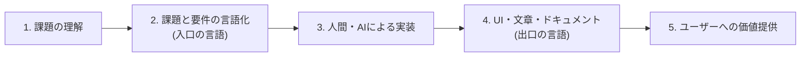

# AI 時代の科学ソフトウェア開発における UX ライティング — 文章を「インターフェースの品質特性」として設計する

> **概要**：AlphaFold 3 検証ワークスペース [FoldLens](https://github.com/Shunsuke-max/foldlens-portfolio)（[ライブデモ](https://shunsuke-max.github.io/foldlens-portfolio/)）の開発・公開を通じて得た、UX ライティングとコンテンツデザインの設計原則、実画面での改善事例、および開発工程に組み込んでいる 8 項目の文章品質チェックリストをまとめた技術ノートです。

---

## 1. 文章は「説明」ではなく、インターフェースそのもの

ソフトウェアにおいて、文章は機能のあとに添える補足説明ではなく、**ユーザーとシステムを接続するインターフェースそのもの**です。

どれほど高度なアルゴリズムや AI モデルが動いていても、利用者が次の 3 点を直感的に理解できなければ、その技術の価値は現場に届きません。

1. **今ここで何ができるのか**
2. **いま何が起きているのか**
3. **次に何をすればよいのか**

この領域は **UX ライティング（UX Writing）** や **コンテンツデザイン（Content Design）** として体系化されていますが、個人開発や研究向けツールでは後回しになりがちです。私自身、FoldLens を外部公開する過程で実際の画面を徹底的に見直し、文章の質がプロダクトの価値を直接左右することを実感しました。

---

## 2. 文章がプロダクトの品質を左右する 3 つの理由

### ① 認知負荷を減らす
同じ処理を実行するボタンや通知でも、書き方ひとつで理解にかかる労力が大きく変わります。

| 分かりにくい表現（システム視点） | 分かりやすい表現（利用者視点） |
| :--- | :--- |
| 処理を実行する | 分析を開始する |
| データの永続化 | 保存する |
| オペレーションを中断する | キャンセルする |
| 認証情報が無効です | もう一度ログインしてください |
| データ取得処理が正常終了しました | データを取得しました |
| 入力値が許容範囲外です | 1〜100 の数字を入力してください |

一つひとつは小さな差ですが、画面全体で積み重なると使いやすさに決定的な差が生まれます。優れたソフトウェアでは、利用者が「操作方法の解読」ではなく**本来の研究・業務の判断**に思考力を使えます。

### ② 文章の曖昧さは、設計の曖昧さを映す
これは開発者にとって特に重要な視点です。ある機能を説明しようとして、

> 「ユーザーの入力に基づいて適切な情報を統合的に提供する機能」

のように抽象的な言葉しか出てこない場合、そもそも機能の目的や境界が設計段階で曖昧なままになっている可能性が高いです。反対に、

> 「服用している薬の副作用を調べる」

と具体的に言い切れるとき、開発者も利用者も機能の目的を共有できます。**自然で明確な文章を書くことは、プロダクト設計そのものを検証する行為**でもあります。

### ③ 信頼性を左右する（特に生命科学・医療・AI 領域）
文章に次のような違和感があると、利用者は無意識にシステム全体の精度や安全性にも疑問を抱きます。

- 画面によって同じ概念の呼び方が違う
- 直訳調や英語混じりの不自然な日本語になっている
- エラーの原因や対処法が示されない
- 必要以上に長い説明や重複する注意書きがある
- 実際の機能や科学的根拠以上のことができるように書かれている

創薬・医療・生命科学のように**判断の正確さと根拠の透明性が求められる領域**では、言葉の精度はそのままプロダクトの信頼性に直結します。

---

## 3. 実例：FoldLens の UI 推敲で何が変わったか

FoldLens のライブデモを日本語化した当初、機能は正しく動いていたものの、画面上には英語混じりの直訳文・重複した注意書き・抽象的なボタン文言が残っていました。UX ライティングの観点で全画面を棚卸しした結果、次のように大きく見通しが改善しました。

| 対象箇所 | 改善前 | 改善後 | 適用した観点 |
| :--- | :--- | :--- | :--- |
| **最重要見出し** | `この予測群で、まず確認すべきこ` / `と`（2行目で1文字孤立） | `まず確認すべきポイント` | 一読理解・レイアウト配慮 |
| **データ品質の警告文** | `Pairwise measurementは確認できますが、現在の決定論的thresholdでは、1つの安定した配置をensemble consensusとして支持できません。` | `各モデル間の測定値は確認できますが、現在の初期基準では、過半数が一致する安定した配置は見つかりませんでした。` | 不要な英単語・直訳調の解消 |
| **モデル比較表の行ボタン** | `詳しく見る` | `3D で開く` | 次行動の明確化 |
| **詳細画面の界面解析ボタン** | `このinterfaceを解析` | `界面の信頼度を診断` | 専門語の整理・次行動の明確化 |
| **ヘッダーの主要ボタン** | `結果を開く` / `レポートを書き出す` | `AF3 ファイルを開く` / `HTML レポートを保存` | 抽象の具体化 |
| **モデル比較表の注意書き** | 2 段落＋全行に `（AF3 公式基準ではありません）` を反復 | 要点を 1 行に統合し、各行は `初期基準内で一致` / `初期基準外` に簡潔化 | 冗長文の削ぎ落とし（情報量の適正化） |
| **PAE 軸と説明** | `縦軸 = scored residue · 横軸 = alignment reference` | `縦軸：評価対象の残基 ／ 横軸：整列の基準残基` | 利用者視点・専門用語の日本語化 |

実際の画面は [FoldLens ライブデモ](https://shunsuke-max.github.io/foldlens-portfolio/) でそのまま確認できます。

---

## 4. 開発者側の文章と、AI 時代における言語設計の重要性

文章の品質が問われるのは UI だけではありません。

| 開発領域 | 文章が果たす役割 |
| :--- | :--- |
| **README** | プロジェクトの目的・検証結果・限界を短時間で伝える |
| **要件定義** | 何を実現し、何を対象外とするかを明確にする |
| **変数名・関数名** | コードの意図と責任範囲を伝える |
| **API ドキュメント** | 正しい利用方法と制約を明確にする |
| **Issue / Pull Request** | 解決する問題と変更理由を共有する |
| **エラーメッセージ** | 問題の原因と次の対処法を案内する |
| **テストケース** | 期待する仕様を検証可能な形で明文化する |

AI によってコード生成コストが下がるほど、開発の**入口**と**出口**にある言語の重要性はむしろ高まります。

入口の言語化が曖昧なら意図しないものが作られ、出口の文章が分かりにくければ、せっかく作った技術も正しく使われません。

---

## 5. 開発工程に組み込む 8 つの文章品質基準

私は現在、コードの自動テストや CI と同様に、UI 文言・README・ドキュメントに対しても以下の 8 項目でチェックする運用を取り入れています（再利用可能なチェックリスト：[ux-writing-checklist.md](ux-writing-checklist.md)）。

1. **一読して意味が理解できるか**
2. **不必要な専門用語・未翻訳語を使っていないか**
3. **抽象的な表現を具体化できないか**
4. **同じ概念に同じ用語を使っているか**
5. **ユーザーが次に取るべき行動が明確か**
6. **実際の機能・科学的限界と説明が一致しているか**
7. **削除しても意味が変わらない冗長な文章がないか**
8. **開発者の都合ではなく、利用者の視点で書かれているか**

---

## おわりに

文章を良くすることは、単に「流暢な日本語にする」ことではありません。流暢でも意味が曖昧な文章や、実態以上に大きく見せる文章は、かえってプロダクトの信頼を損ないます。

**文章の自然さ、意味の正確さ、概念の一貫性、情報量の適切さ。**

この 4 つを、コードの可読性・保守性やテストカバレッジと同じ**ソフトウェアの品質特性**として設計・レビューし続けることを、自分の開発原則に据えています。
